# Cinematic Vex — vrais rendus Blender 0.9.1

Six comparatifs **Cinematic**, LOD 0, graine 42, Blender 4.3.2/Cycles/AgX/OIDN, plafond 128 samples. Les PNG sont les sorties Blender originales. Les deux animations sont réellement rendues en **Balanced**, LOD 0, 48 samples maximum, 480×360 à 24 FPS.

## Avant / après

| Vue | Avant — PR #20 | Après — 0.9.1 | Durée après / pic RSS du processus |
| --- | --- | --- | --- |
| Athéon de face | 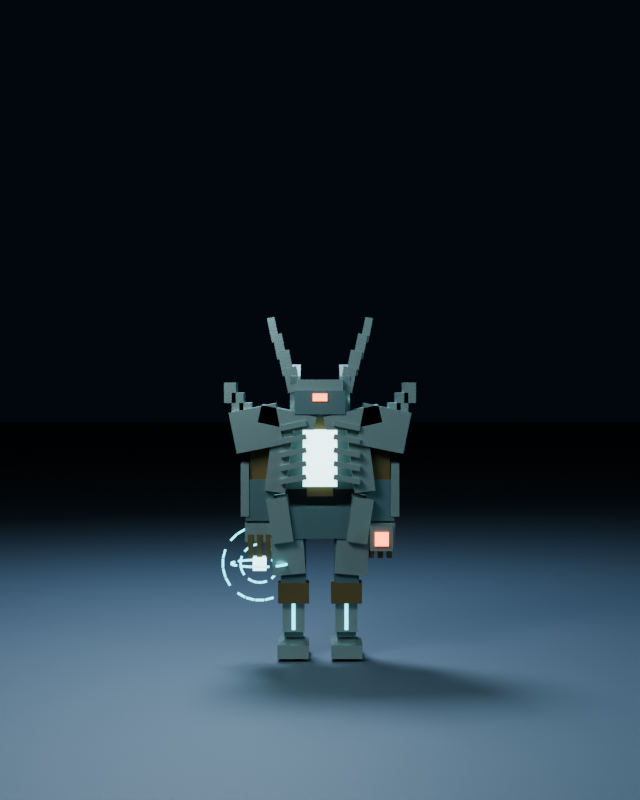 | 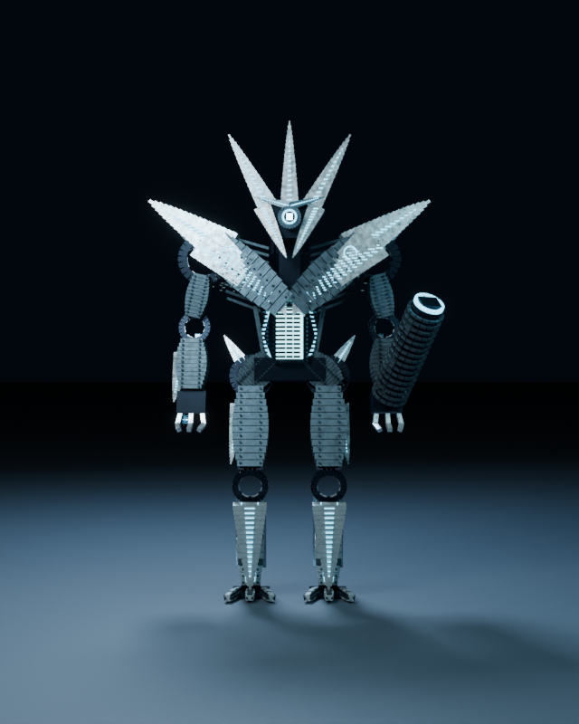 | 76.37 s / 796.3 MiB ([rapport](reports/front-after.json)) |
| Athéon de profil | 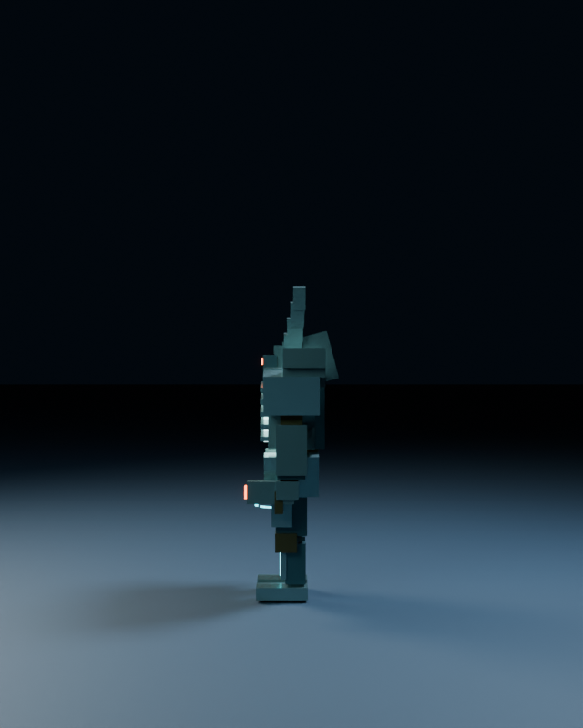 | 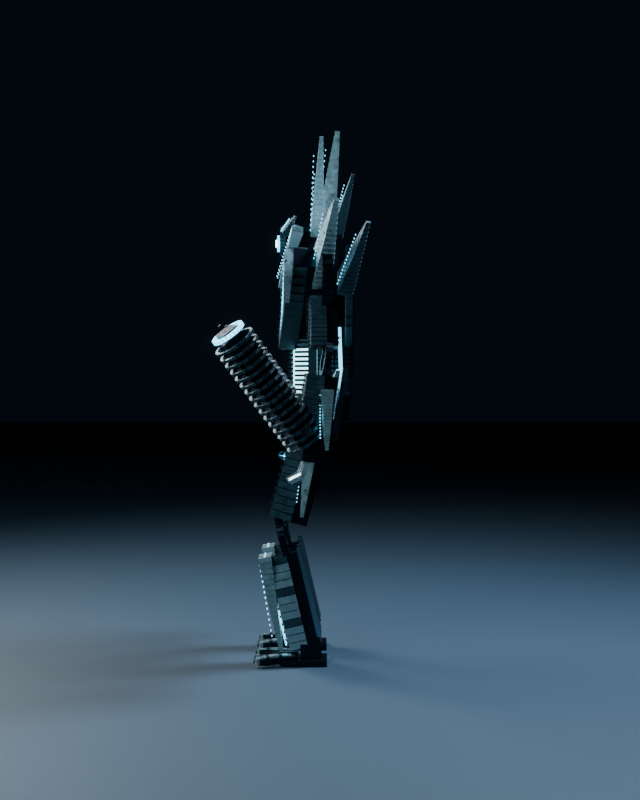 | 42.46 s / 798.7 MiB ([rapport](reports/profile-after.json)) |
| Contre-plongée | 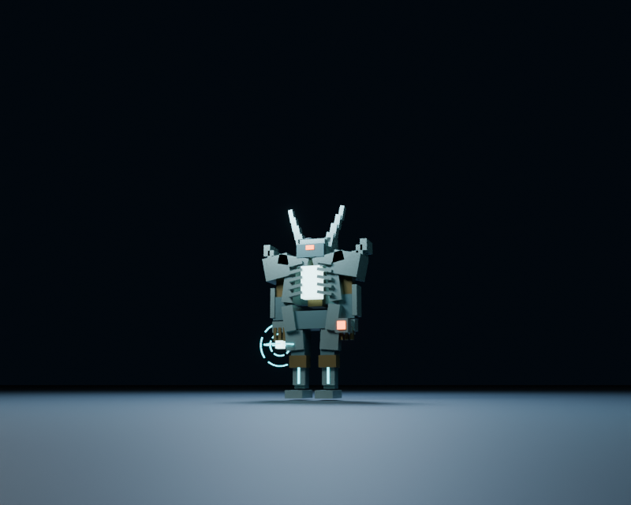 | 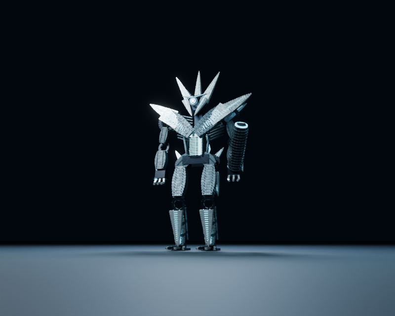 | 60.99 s / 799.1 MiB ([rapport](reports/low-angle-after.json)) |
| Tête et torse | 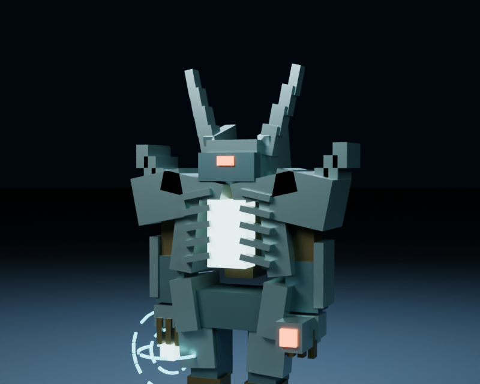 | 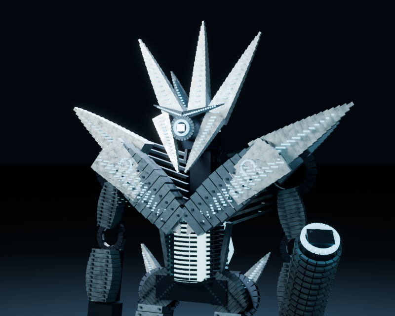 | 191.30 s / 798.6 MiB ([rapport](reports/head-torso-after.json)) |
| Trône de verre | 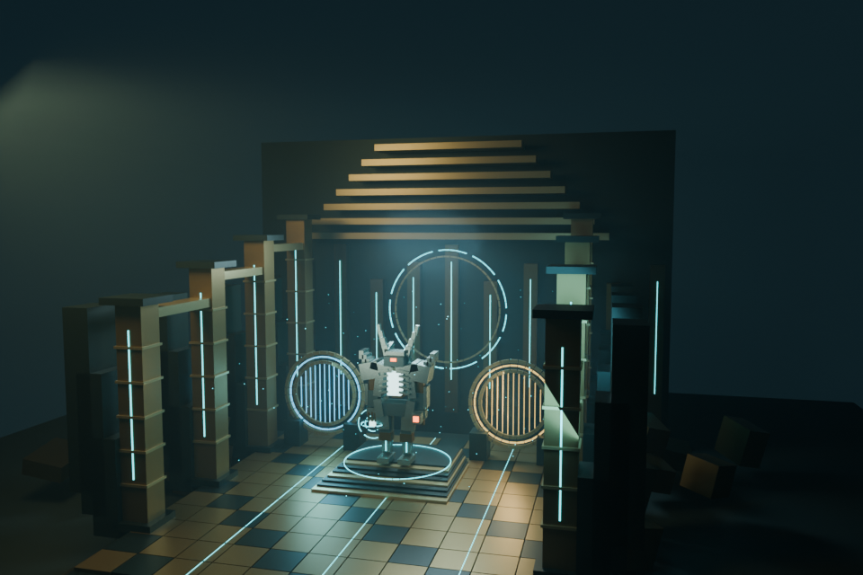 | 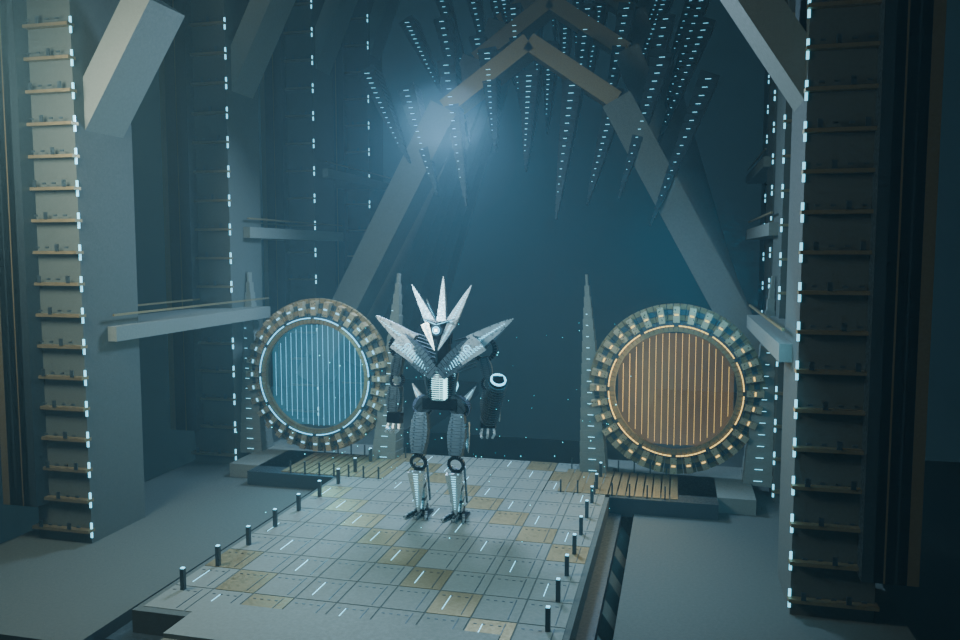 | 575.19 s / 899.6 MiB ([rapport](reports/throne-after.json)) |
| Templier dans son arène | 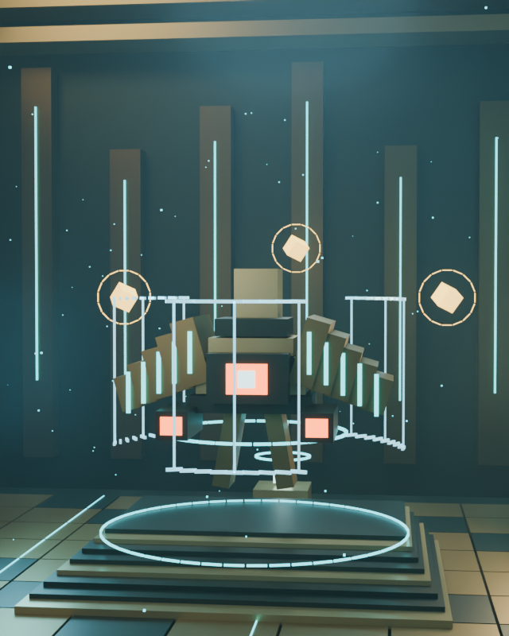 | 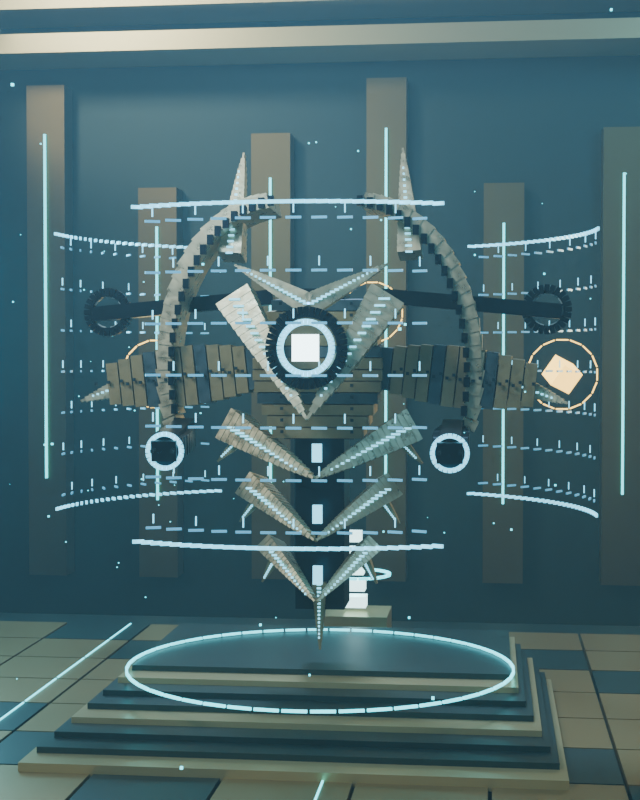 | 463.96 s / 788.5 MiB ([rapport](reports/templar-after.json)) |

Le code avant est gelé au commit `b1fd922fd495037daf897c9eca7713fcf69c4f1a`. Les quatre vues anatomiques utilisent le même studio et les mêmes réglages. Les cinq paires hors gros plan ont des matrices caméra identiques. Pour le gros plan, la caméra et sa cible avant sont translatées de −5,1 m verticalement pour retrouver la tête plus basse ; focale, orientation et distance restent identiques. Les deux vues en arène montrent les décors et éclairages respectifs complets. Le champ historique `request.camera=wide` des rapports avant sert au contrat ancien ; `shot.sharedCamera` et `cameraMatrixWorld` décrivent le cadrage réellement rendu.

## Animations Balanced

| Clip | Durée / images | Rendu cumulé / moyenne par image | Pic RSS |
| --- | --- | --- | --- |
| [walk](clips/walk.mp4) | 2 s / 48 | 2632.96 s / 54.85 s | 588.0 MiB ([rapport](reports/walk-clip.json)) |
| [temporal](clips/temporal.mp4) | 1.5 s / 36 | 1160.17 s / 32.23 s | 582.0 MiB ([rapport](reports/temporal-clip.json)) |

Marche :

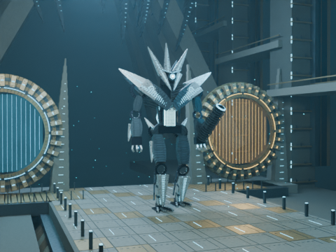 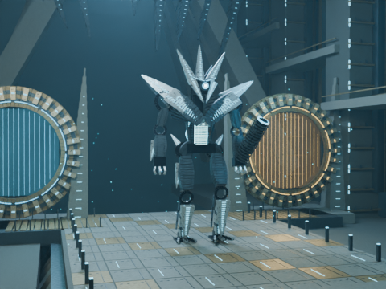 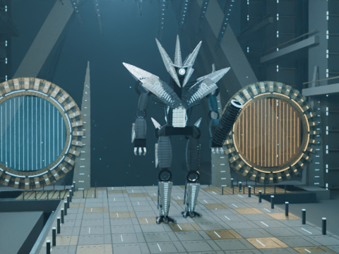

Manipulation temporelle :

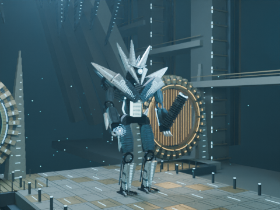 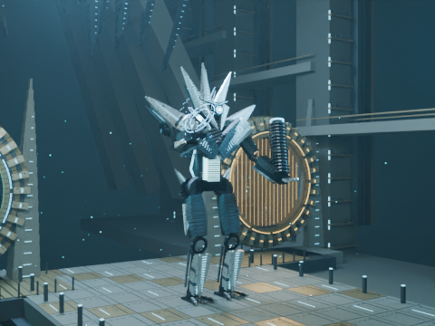 

## Inspection et limites

Inspection des silhouettes face/profil, de la couronne à trois lames, des épaules en chevron, du canon asymétrique et des longues jambes : la nouvelle anatomie se distingue de la base compacte. Le Templier garde une silhouette flottante à coque et segments ventraux, distincte du bipède. Les gros plans montrent les plaques, cavités et articulations ; les frames de marche et d’énergie montrent les changements de pose et d’émission. Cette interprétation voxel originale conserve des volumes anguleux ; elle ne reproduit pas exactement le modèle ni la carte du jeu.

Athéon : **3245 / 1108 / 437** pièces aux LOD 0/1/2, 18 articulations. Templier : **1835 / 674 / 245**, 13 articulations. Les previews et clips gardent tous le LOD 0.

Le contrôle natif de 136 évaluations mesure une erreur IK maximale de 0,00000120 m et un glissement d’appui de 0,00000172 m. Les plaques décoratives sont 3 cm au-dessus du plan nominal des pieds : une légère pénétration locale subsiste (mesurée 0,030001 m, tolérance 0,04 m). Ce contrôle géométrique ne constitue pas une simulation physique. La marche est limitée à deux cycles puis maintient les appuis ; pas de combat physique, projectiles simulés ou portails récursifs.

Matériel réel : **CPU AMD EPYC 9V74, 3 threads disponibles**, aucun GPU détecté. Les durées incluent une possible contention CPU et ne constituent pas un benchmark comparatif contrôlé. RSS = mémoire du processus, pas VRAM. GPU, Tesla T4, Colab Pro et Android non testés ; aucune amélioration GPU revendiquée. Les clips sont muets et ne touchent pas aux épisodes, à Kokoro ou aux sous-titres.

[Empreintes, matériel et métriques](evidence.json) · [Sources et direction artistique](../../../remotion/blender/cinematic_vex/ART-DIRECTION.md) · [Commandes et Colab](../../../remotion/blender/cinematic_vex/README.md)
