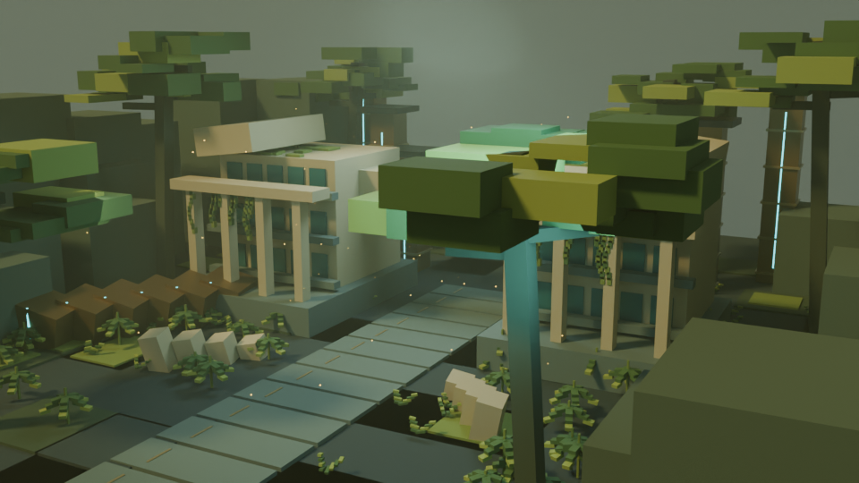
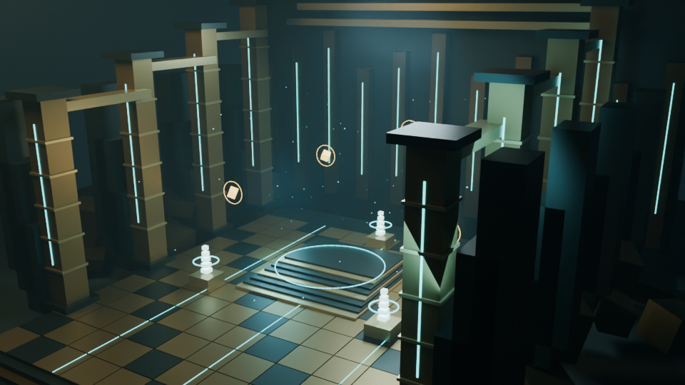
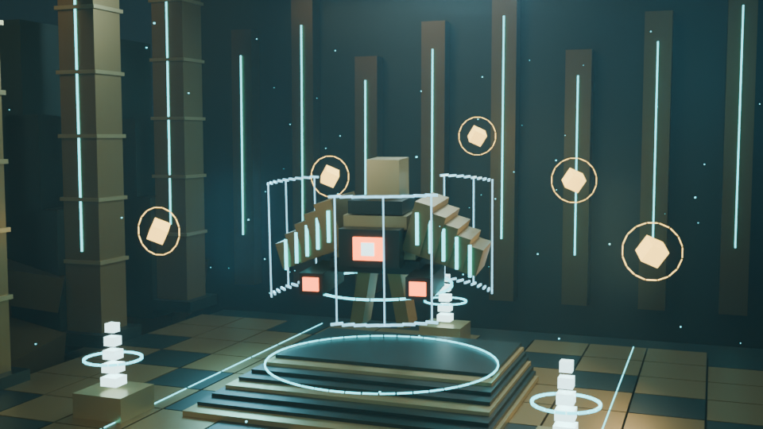
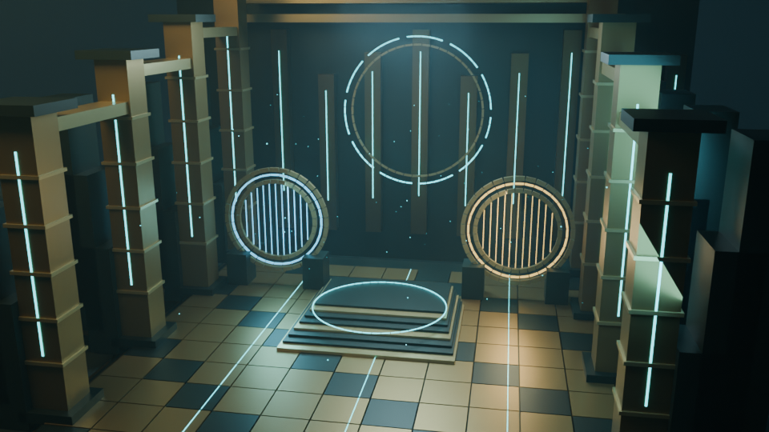
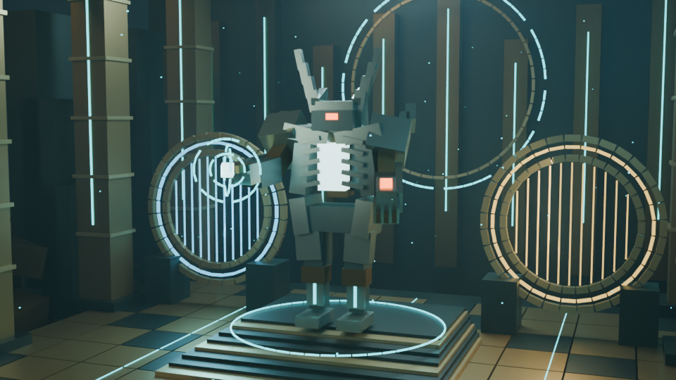
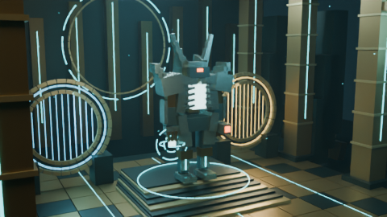
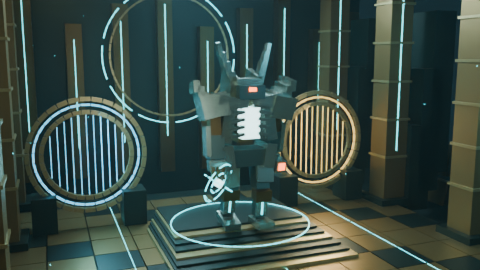
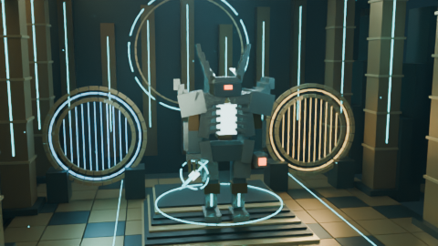

# Prévisualisations Blender — Vénus et le Caveau de verre

Images réellement rendues dans **Blender 4.3.2 officiel / Cycles**, graine **42**, AgX et OpenImageDenoise. Interprétations voxel originales : aucune géométrie ou texture propriétaire importée. Sélection par les IDs existants de l’Atlas ; aucune nouvelle identité.

## Mesures effectives CPU

Linux, AMD EPYC 9V74 (trois CPU logiques exposés), trois threads. `device=auto` a sélectionné **CPU** dans tous les rapports. Pas de T4 disponible ; GPU, Colab Pro et Android non testés. Les temps sont ceux de ces validations, avec concurrence CPU possible, **pas un benchmark comparatif**.

| Vue / clip | Pixels / images | Profil / samples | Temps dans Blender, construction comprise | Moyenne de rendu par image | Pic RSS processus |
| --- | --- | --- | ---: | ---: | ---: |
| Vénus / Académie Ishtar | 960×540 / 1 | balanced / 48 | 147.45 s | 147.14 s | 785.4 MiB |
| Puits du Templier | 960×540 / 1 | balanced / 48 | 131.93 s | 131.86 s | 781.1 MiB |
| Le Templier | 960×540 / 1 | balanced / 48 | 257.47 s | 257.20 s | 777.6 MiB |
| Trône de verre | 960×540 / 1 | balanced / 48 | 229.80 s | 229.70 s | 779.4 MiB |
| Athéon / énergie temporelle | 960×540 / 1 | balanced / 48 | 129.26 s | 129.19 s | 785.1 MiB |
| Athéon / marche et travelling | 480×270 / 48 | draft / 16 | 598.21 s | 12.46 s | 492.4 MiB |

Le clip comporte **48 images à 24 FPS, soit 2 secondes**, H.264/yuv420p, sans audio. Les cinq vues fixes sont Balanced ; le clip est Draft à résolution réduite pour valider le mouvement sur CPU. Cinematic reste disponible pour les rendus de production ; aucune mesure de ce profil ni amélioration GPU n’est revendiquée. Le pic RSS Linux n’est pas une mesure de VRAM. Les rapports JSON donnent requête, caméra par frame, SHA-256 des PNG et de la géométrie, samples et notes de fallback.

## Vénus — vue générale

[Rapport Vénus](venus.report.json). Sous-bois, lianes et ruines Golden Age ; la perspective et les bâtiments sont une composition artistique, pas une carte exacte.

## Puits du Templier

[Rapport de l’arène](templars-well.report.json). Conflux, oracles et géométrie monumentale ; le cadrage latéral conserve une colonne au premier plan.

## Templier en situation

[Rapport du Templier](templar.report.json). Pose d’attaque à la frame 12 ; œil central, ailettes de coque, canons et bouclier segmenté. L’attaque ne simule ni projectile ni dégâts.

## Trône de verre

[Rapport de l’arène](glass-throne.report.json). Les deux portails sont des cadres lumineux avec champ en grille ; pas de rendu récursif d’autres époques.

## Athéon en situation

[Rapport d’Athéon](atheon.report.json). Pose temporelle à la frame 30 ; cornes, armure, cœur lumineux, canon et énergie articulée. Proportions et détails sont une réinterprétation voxel originale.

## Séquence animée

[Télécharger/voir le clip H.264 de deux secondes](atheon-walk.mp4) · [Rapport des 48 frames](atheon-walk.report.json)

Marche articulée et travelling orbital, avec ressources statiques conservées. Pas d’IK de contact au sol. Inspection des trois poses ci-dessus et vérification du conteneur/codec/durée par ffprobe.

## Reproduire et vérifier

[Guide de lancement et Colab](../../../remotion/blender/venus_vault/README.md) · [Validation et limites](../../../remotion/blender/venus_vault/VALIDATION.md) · [Métadonnées et empreintes](evidence.json)

Depuis la racine : `python remotion/blender/venus_vault/verify_evidence.py` (ffprobe requis). La vérification compare les médias livrés, les dimensions, les hashes, les caméras et la géométrie courante. Les dossiers de rendu complets avec logs ne sont pas versionnés ; le rapport conserve les 48 hashes et trois PNG représentatifs accompagnent le MP4. Aucun épisode historique, voix Kokoro ou sous-titre n’est modifié.
