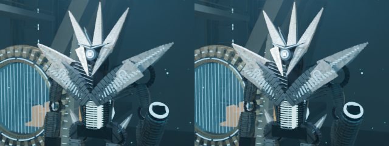
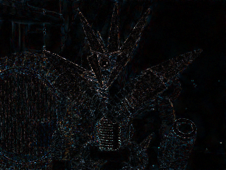

# Standalone GPU lab validation

## What was executed

- **118 Node tests, 117 Python tests** (67 Blender/controller, 36 Studio, 10 narration, 4 manifest) and all three TypeScript configurations pass.
- Eleven targeted lab tests cover path/Drive/episode isolation, symlink-safe cleanup, final-output preservation, ZIP traversal/checksum validation, identical source jobs, supported-only settings, cold/warm/CPU/fallback/OOM exclusion, scene-signature identity, meaningful-gain gates, explicit export approval, serialized workspace actions, RGB quality metrics and a temporal residual fixture.
- A real sparse/partial GitHub checkout was created and the standalone planner executed successfully: approximately **3.7 MiB**, with **no narration WAVs or npm dependencies**.
- Blender 4.3.2 actually rendered **six CPU images**: baseline 48 and 32 samples, one frame from each of three approved cinematic shots, **320×240**, Balanced, LOD0, seed 42. Geometry/camera/light signatures matched between cases. This is component validation, not a T4 benchmark or a production-quality verdict.
- Actual FFmpeg side-by-side images, ×4 difference maps, PSNR and SSIM were generated. Actual offline HTML/JSON/raw logs/telemetry were packaged in a CRC-checked ZIP. Disposable intermediate files were deleted only inside the dedicated marked lab run, while final images/reports/ZIP remained. The actual ZIP was restored into a new local report directory and checksums verified.
- An actual native Blender preflight without a T4 correctly refused GPU benchmarking rather than silently rendering on CPU. The explicit CPU-validation mode is development-only and cannot produce GPU ratios, projections or an O4 recommendation.
- Existing Studio and Lot C evidence checks pass. Approved models, all shot definitions, original English script/WAV/word timestamps, historical episodes and the production notebook remain unchanged.

[Machine-readable scope](gpu-lab-evidence/validation.json) · [CPU-only example ZIP containing full HTML/JSON/images/logs](gpu-lab-evidence/cpu-component-results.zip) · [CPU example results](gpu-lab-evidence/cpu-component-results.json).

## Real quality-comparison example — CPU only





Recorded PSNR/SSIM against baseline 48 were approximately 36.13 dB / 0.963 (environment), 36.76 dB / 0.983 (portal), and 35.05 dB / 0.972 (mechanism). These values neither approve 32 samples nor prove equivalence, particularly at the actual 540×960 target resolution. No temporal conclusion is drawn from this single-frame fast component run. Standard mode's residual calculation was separately exercised with explicitly synthetic unit fixtures, not presented as real moving-shot evidence.

GPU metrics and GPU speed ratios in the CPU example are **null**, not zero or inferred from CPU timings. Source commit/hashes are embedded in the raw example. Final timeout, fallback-detection and approval-gate changes do not alter the approved builder or image-producing worker.

## User evidence and remaining target acceptance

The [provided M3 aggregate](gpu-lab-evidence/user-reported-m3.json) is acknowledged as real user-reported T4/OptiX data, but it is **warm/partially cached** (19 new / 11 reused), not a cold trial from the new lab. Its 285.40-second render/compositor operation is about 97% of invocation wall time. It cannot retrospectively separate exclusive GPU kernels, transfers, CPU denoising or compositor cost, and it is not used to claim speedup.

**Not executed here:** actual Colab/T4 cold six-case matrix, GPU denoiser/compositor runtime probes, GPU OOM/recovery, physical Android, optional Drive mount/save/restore or a full episode render. The initial default-settings probe was CPU-side Blender 4.3.2, not proof of the user's active T4 denoiser settings. O2 captures those settings and probes actual supported GPU features.

The deliverable is an independent reproducible investigation workflow, not a claim that a production optimization has already won on T4. The conservative recommendation remains **Balanced/48** until the user's standard O2 results and human visual/temporal review justify O4. No full 2672-frame rendering, automatic production changes, PR merges, PR #17 integration or GitHub Actions are involved.

## Reproduce local checks

```sh
python -m unittest discover -s remotion/blender/tests
python -m unittest discover -s remotion/studio -p 'test_*.py'
python -m unittest discover -s remotion/tests -p test_manifest_import.py
python -m unittest discover -s remotion/tests -p 'test_*narration.py'
python remotion/studio/verify_smoke.py
python remotion/blender/universal/lot_c_evidence.py --check
cd remotion
node --experimental-strip-types --test tests/*.test.mjs blender/tests/*.test.mjs studio/*.test.mjs
node --experimental-strip-types scripts/asset-audit.mjs --check
npx tsc --noEmit
npx tsc --noEmit -p atlas/universal/tsconfig.json
npx tsc --noEmit -p studio/tsconfig.json
```

Use the existing pinned environment for legacy narration tests. The new standalone lab itself uses only Python's standard library, Blender 4.3.2 and ffmpeg/ffprobe; no voice or Node installation is required. [Exact O1–O4 instructions](GPU-OPTIMIZATION-LAB.md).
