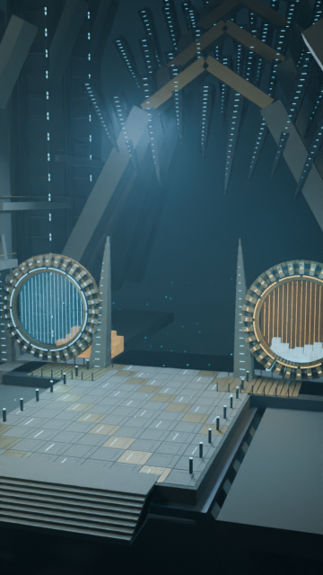
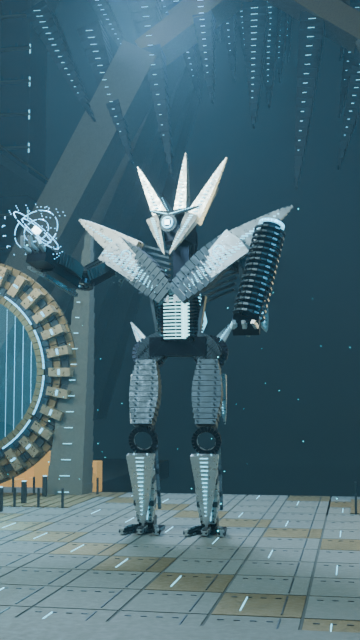
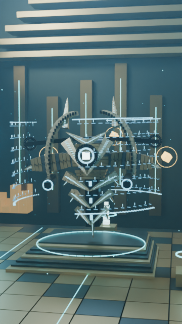
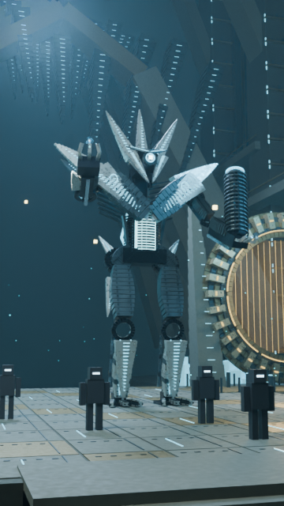
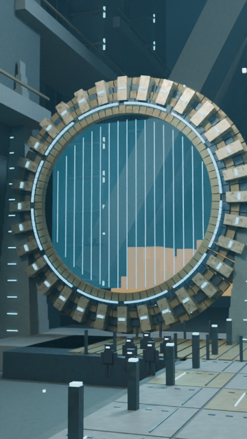
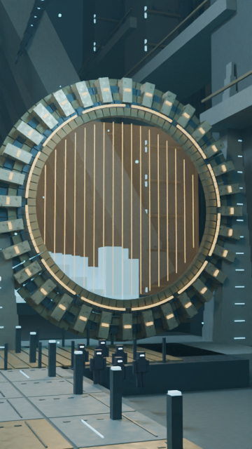

# Real CPU previews, not a T4 benchmark

All six images below were actually rendered in Blender 4.3.2, CPU, Balanced 48 samples, existing denoiser, LOD0, 360×640. Approved boss geometry is unchanged. Raw requests, frame identities and devices are in [validation.json](validation.json); [checksums.json](checksums.json) records artifact hashes. This is a partial shot review, not complete motion acceptance or a finished episode.

| Establishing Vault | Atheon reveal | Templar in his arena |
| --- | --- | --- |
|  |  |  |

| Guardian silhouettes | Past portal reconstruction | Future portal reconstruction |
| --- | --- | --- |
|  |  |  |

The portal views were rerendered after discovering a column occluded the original trajectory. Landscapes and anonymous silhouettes are original editorial reconstructions. These are stills; disappearance, portal flicker, cuts and battle choreography still require full motion review on Colab.

[Subtitle layout screenshot](caption-layout.png) shows the actual new Remotion composition with original native word times. It uses one genuine still as a **UI-layout fixture**, not a rendered animation. [Scope](caption-layout-scope.json).

The [three-frame silent benchmark montage](benchmark-montage-not-episode.mp4) exercises real Remotion/H.264 export of three distinct rendered shots. It lasts 0.1 seconds, has no pilot audio and is explicitly **not the episode or an animation clip**. [Export timing](remotion-montage-result.json) includes bundling/browser startup; it cannot predict the full episode's export.

[Reference PNG](reference-current-pipeline.png) and [instrumented PNG](instrumented-save.png) were rendered with identical original CPU frame/settings. The [ffmpeg PSNR result](cpu-save-equivalence-psnr.log) is infinite: decoded pixels are identical for this single-frame render/save separation check. This does not validate reduced samples, T4 performance or every frame.

[Cold local controller result](cpu-three-shot-cold.json) and [warm resume](cpu-three-shot-warm.json): three cache hits, zero new frames, zero scene builds on the warm invocation. Copies labeled Drive in those raw reports used ordinary local directories; no real mounted Drive was tested. CPU trials ran alongside development checks and are not performance benchmarks. GPU measurements are null because no NVIDIA device was available.
