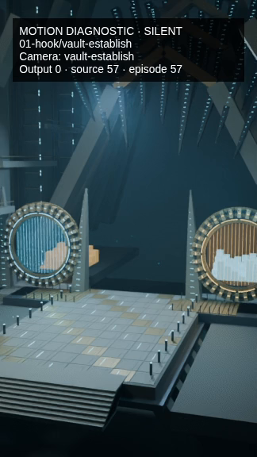
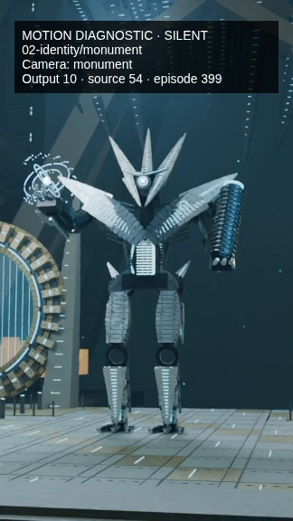
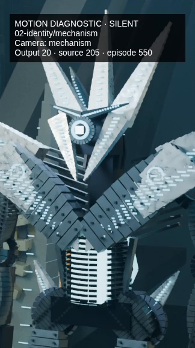

# Actual three-shot motion diagnostic

[Play the genuine three-second H.264 clip](atheon-motion-test.mp4). **30 real Blender images, 10 output FPS, 324×576, Draft, LOD0, CPU**, no original narration. Motion samples every third native 30-FPS source frame, with no still repetition or interpolation. This is not the completed episode or a T4 benchmark.

| Vault establishing | Monumental Atheon | Mechanism close-up |
| --- | --- | --- |
|  |  |  |

These are frames 0, 10 and 20 extracted from the actual MP4, including its diagnostic overlay. All three shots also move within the clip. Recorded camera translation spans are approximately 5.58, 3.05 and 0.91 Blender units; source images and camera matrices differ at every rendered step. Approved geometry is unchanged.

- [Validation / original render phases](motion-validation.json).
- [Original cold run](cold-render-result.json), [real warm resume](warm-render-result.json): 30 verified cache hits, zero new frames, zero scene builds, unchanged MP4 hash. Warm data is not a GPU speedup benchmark.
- [Actual per-frame camera observations](per-frame-cameras.jsonl), extracted from the preserved original frame records. These are original measured matrices, not simulated transforms or invented timestamps. The raw `frames-motion-*.json` files retain all original per-frame diagnostics and CPU scheduling measurements.
- [Complete 19-shot / 2672-camera-position audit](all-frame-camera-audit.json). This audit rendered **zero** episode images.
- [Raw Blender stdout](blender-log.txt), [exact motion plan](motion-plan.json), [actual CPU device probe](actual-local-device.json).
- [Archived general-Studio inspector example](archived-general-route-example.json) is a real older 2-second Rhulk smoke, **not the user's Atheon MP4**.
- [Scope summary](validation-summary.json), [artifact hashes](checksums.json).

No NVIDIA GPU or mounted Google Drive was available locally. GPU utilization/power/VRAM are null. Local phase timings include ordinary local disk checkpointing and some concurrent development tests; they do not predict Colab/T4 behavior. Run R0 then M1/M2/M3 on the user's actual T4 before considering a full rerender.
