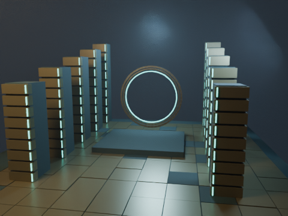
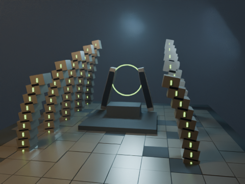
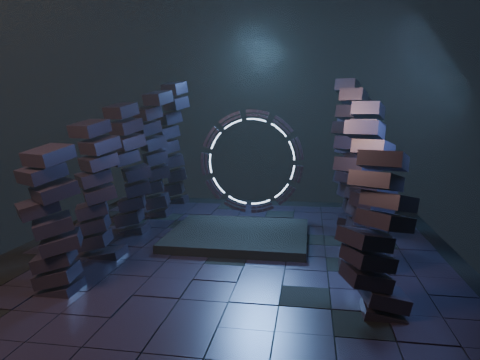
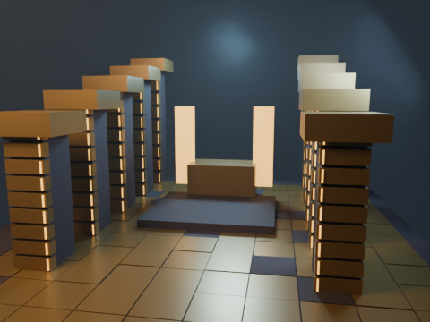
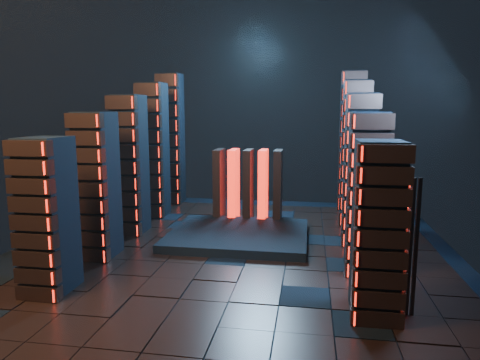
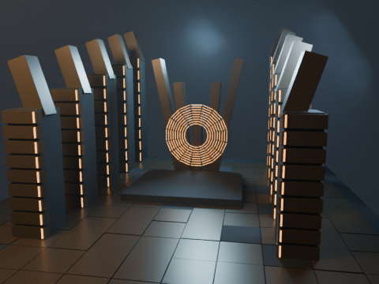
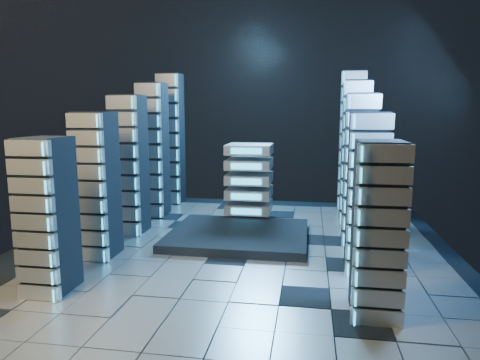
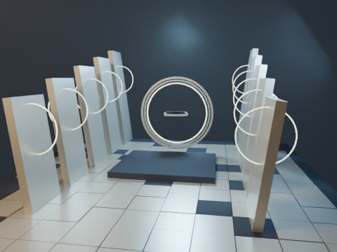
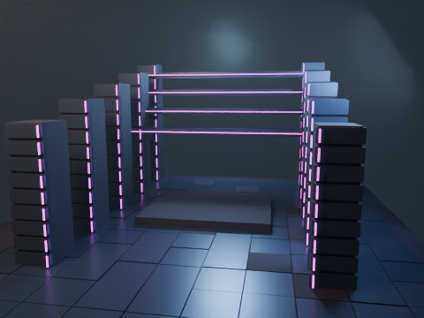
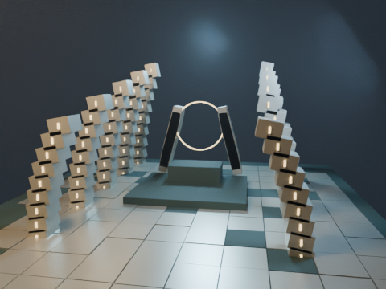

# Bibliothèque cinématographique universelle — chantier v1.0

Lot A : registre et pipeline additionnels, dix familles architecturales et index consultable. Les 128 entrées de boss, 25 formes et 147 lieux de l’Atlas restent distincts. **La bibliothèque complète n’est pas terminée.** Les composants de famille ne sont jamais présentés comme des boss dédiés ni des arènes nommées terminées.

Athéon et le Templier sont conservés exactement à la version 0.9.1 validée par l’utilisateur : leurs cinq fichiers de modèle/animation/matériaux sont protégés par SHA-256. Aucun épisode, contrat historique, Kokoro, Remotion ou sous-titre n’est modifié. Aucun commit de PR #17 n’est intégré.

## Index consultable

Depuis la racine du dépôt : `python -m http.server 8000`, puis ouvrir `http://localhost:8000/docs/universal-library/`. Recherche, filtres par activité/état/type, liens aux rencontres, arènes, variantes et sources, aperçus réellement disponibles et export d’une sélection JSON. Cette interface est un compagnon additionnel : elle ne modifie pas l’éditeur d’épisodes historique. Le JSON exporté décrit une sélection, pas un épisode prêt à rendre.

[Catalogue généré](catalog.json) · [Plan de travail complet](WORKSTREAM.md) · [Audit des branches](BRANCH-AUDIT.md) · [Guide CLI / reprise / Colab](../../remotion/blender/universal/README.md)

## Dix études d’architecture réellement rendues

Blender officiel 4.3.2, Cycles, graine 42, Draft (16 samples maximum), **LOD 0 indépendant de la résolution**, 480×360. CPU AMD EPYC 9V74, 3 threads ; GPU/T4/Colab/Android non testés. Ces premiers aperçus vérifient les modules et la chaîne, sans valider la fidélité d’une arène spécifique. Les associations de famille sont des candidats éditoriaux (ex. Awoken/Corrompus), pas des classifications canoniques déduites automatiquement.

| Famille | Étude procédurale |
| --- | --- |
| Vex / Jardin noir |  |
| Ruche |  |
| Corrompus / Ascendant |  |
| Cabals / Léviathan |  |
| Éliksni / SIVA |  |
| Pyramides / Résonance |  |
| Âge d’or / Bray |  |
| Neuf |  |
| Néomuna |  |
| Voyageur / Cœur pâle |  |

[Rapports et empreintes](studies/evidence.json) : les rapports individuels conservent sources, requête, backend effectif, temps par frame, matrices, mémoire RSS du processus et empreintes. VRAM/utilisation GPU inconnues. La cache de design est un JSON de géométrie ; ce n’est pas une scène `.blend` persistée entre sessions. Blender reste unique pendant chaque invocation, avec ressources statiques réutilisées entre frames. Les PNG complets sont décodés et vérifiés avant reprise ; les sorties partielles ne comptent pas comme complètes.

Les anciens rendus d’Athéon et du Templier restent accessibles dans l’index. Leur grille complète de cinq vues v1.0 n’est pas encore livrée : l’état `galleryV1Status` reste partiel. Savathûn manque du catalogue documentaire actuel ; son entrée et ses sources doivent être ajoutées avant tout binding de modèle.
