# Grilles d’Athéon et du Templier — modèles validés conservés

Les modèles restent exactement ceux de 0.9.1 validés par l’utilisateur. Cette grille ajoute des cadrages et une animation du Templier ; elle ne redessine ni ne modifie leurs silhouettes, matériaux ou animations. Les sources originales sont protégées par SHA-256 et les 136 + 156 contrôles natifs Blender passent.

| Modèle | Face | Vue oblique | Silhouette monochrome | Environnement |
| --- | --- | --- | --- | --- |
| Athéon | 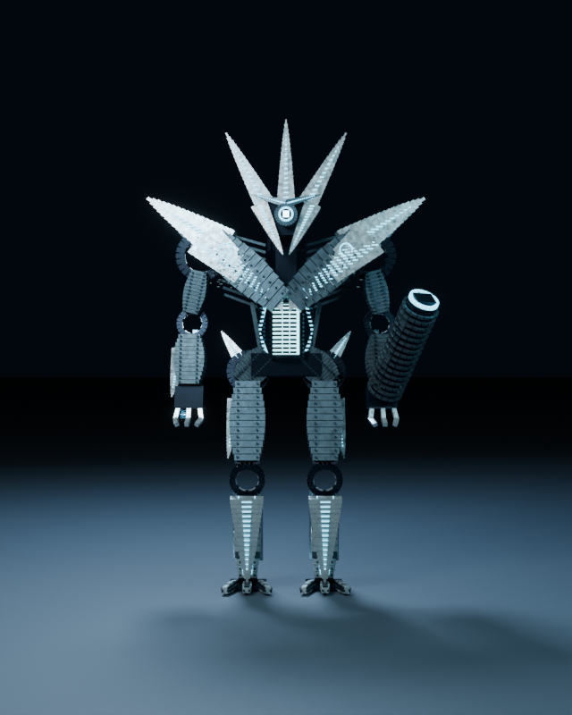 | 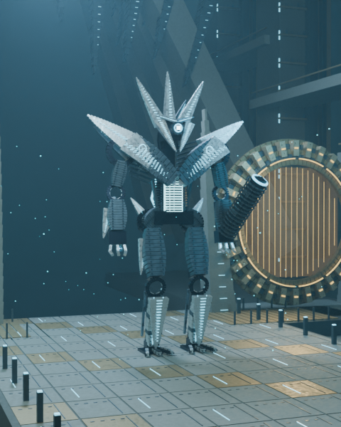 | 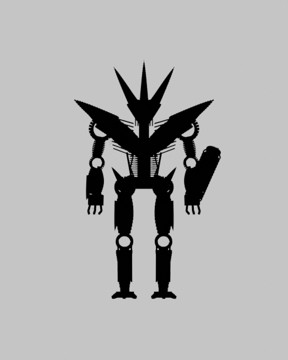 | 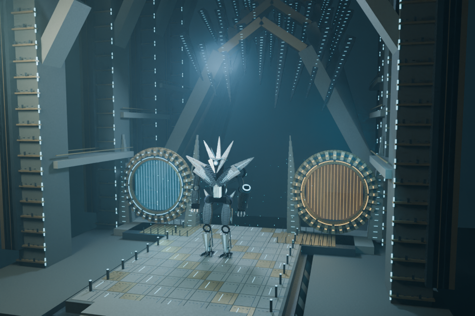 |
| Templier | 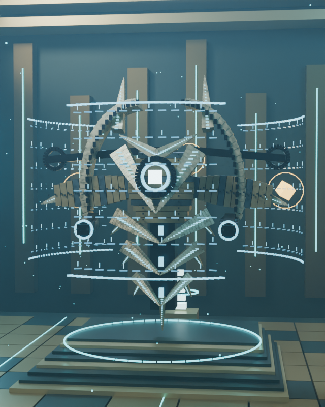 | 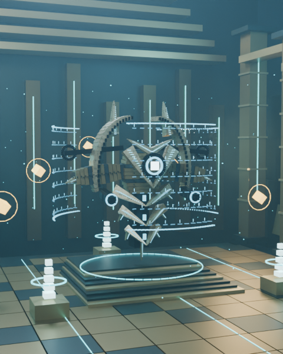 | 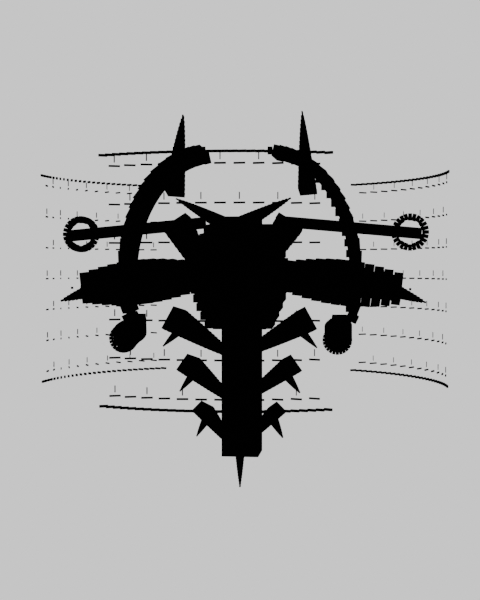 | 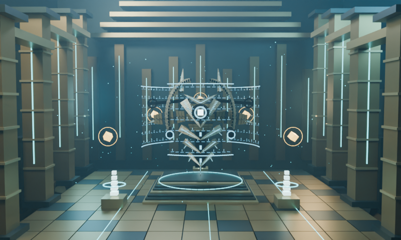 |

Les vues « trois-quarts » du pipeline utilisent le preset orbital existant à sa frame 0, soit une vue oblique légère d’environ 20°. Leur angle réel est enregistré par matrice dans les rapports ; elles ne sont pas présentées comme des rotations exactes de 45°. Pour un angle plus prononcé, le même preset peut être échantillonné plus tard (par exemple frame 272 à 24 FPS), sans modifier la géométrie.

Les images de face et le Trône large proviennent des preuves Cinematic 0.9.1 conservées. Les silhouettes et vues obliques sont de nouveaux rendus Cycles Cinematic 128 maximum, **480×600, LOD0** ; le nouveau Puits large est en **800×480**. Tous sont de vrais PNG Blender, sans retouche ni image de substitution. Graine 42, Blender 4.3.2 officiel, AgX/OIDN. Les fonds monochromes viennent d’un override de matériau dans Blender, pas d’un filtre appliqué après rendu.

## Animations Balanced

- [Marche d’Athéon — 48 frames, deux secondes](../../previews/cinematic-vex-0.9.1/clips/walk.mp4), preuve 0.9.1 conservée.
- [Rotation du Templier — 24 frames, une seconde](boss-templar-rotate.mp4), nouveau rendu.

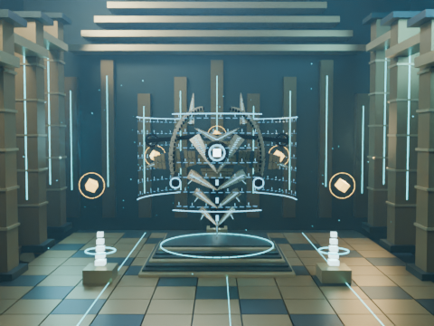 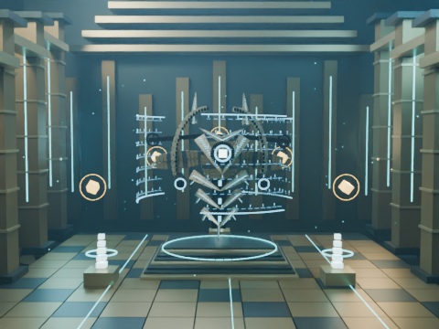 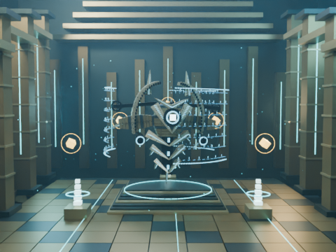

Les deux clips utilisent Balanced 48 maximum, **LOD0**, 480×360 à 24 FPS, H.264/yuv420p, muets. Kokoro, Remotion et les sous-titres historiques restent inchangés. Les PNG représentatifs et vidéos sont validés par SHA-256, dimensions, décodage et nombre de frames.

[Manifest des preuves et rapports](evidence.json). CPU AMD EPYC 9V74, trois threads par rendu ; plusieurs processus concurrents peuvent allonger les temps. Les pics RSS désignent la mémoire du processus et ne sont pas des mesures VRAM. GPU/T4/Colab/Android non exécutés, aucun gain GPU annoncé. Cette grille constitue une validation technique additionnelle ; elle ne prétend pas que l’utilisateur a examiné ces nouveaux cadrages.

```sh
python remotion/blender/universal/approved_gallery.py --check
python remotion/blender/cinematic_vex/verify_evidence.py
```

## Mesures CPU des nouveaux rendus

| Sortie | Temps cumulé de rendu | Pic RSS |
| --- | --- | --- |
| boss-atheon-silhouette-report | 12.49 s | 626.9 MiB |
| boss-atheon-three-quarter-report | 396.22 s | 650.9 MiB |
| boss-templar-environment-report | 178.70 s | 687.8 MiB |
| boss-templar-rotate-report | 881.23 s | 545.0 MiB |
| boss-templar-silhouette-report | 12.49 s | 606.8 MiB |
| boss-templar-three-quarter-report | 290.75 s | 621.7 MiB |
