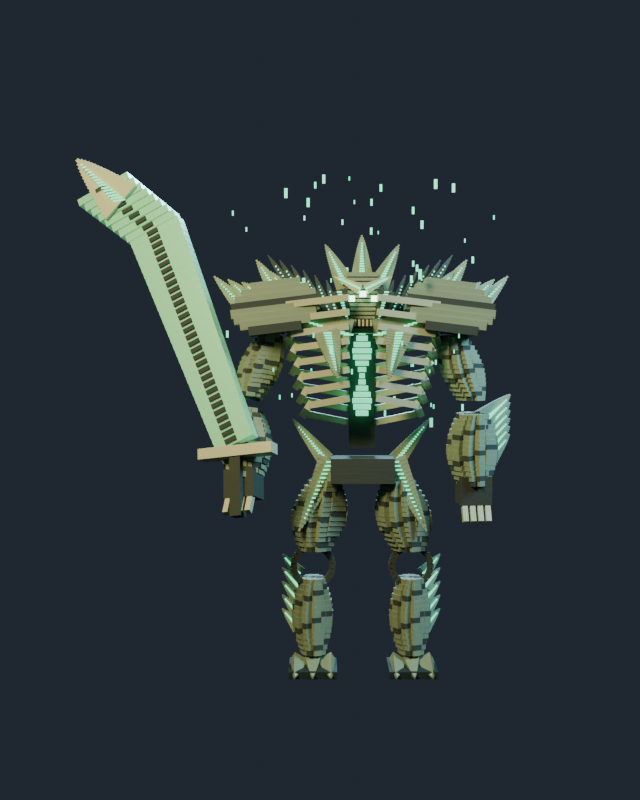
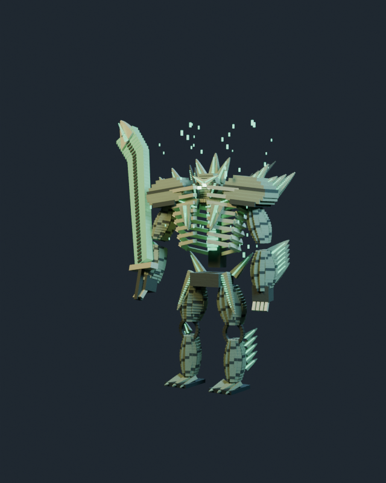
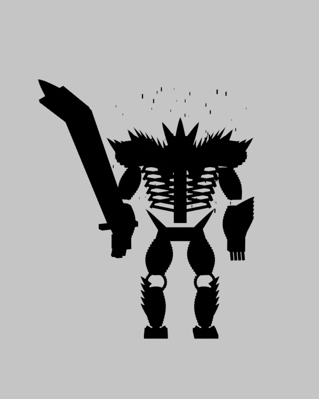
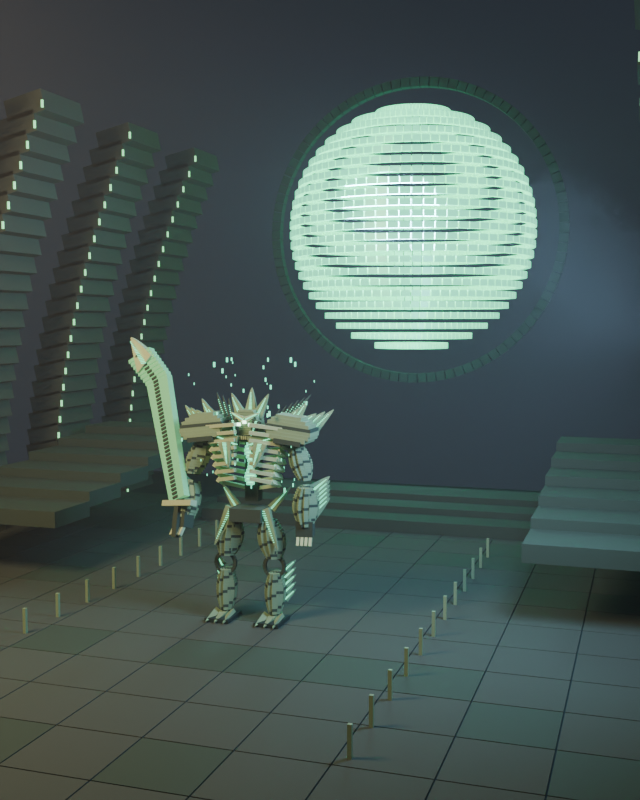
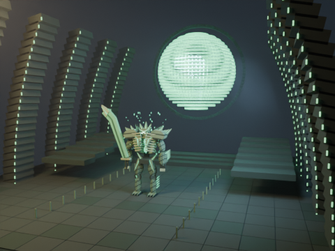
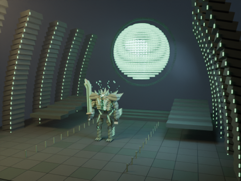
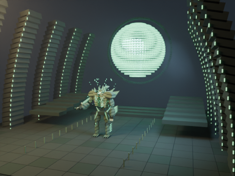

# Cropta — lot B, prototype dédié partiel

Modèle original et arène `oversoul-throne`, reliés aux rencontres de Cropta D1/D2 dans l’Atlas existant. **Ce prototype n’est pas déclaré artistiquement terminé ni validé par l’utilisateur.** Athéon et le Templier ne changent pas.

Repères travaillés : trois yeux, crâne à épines, épaules osseuses dentelées, cage thoracique ouverte, âme verte, grandes griffes et énorme épée recourbée. Aucun modèle ni texture extrait du jeu. Les [références visuelles consultées](../../../remotion/blender/universal/crota-visual-references.json) sont des liens et empreintes ; leurs images restent hors du dépôt et ne sont jamais utilisées par les shaders.

| Vue | Vrai rendu Blender |
| --- | --- |
| Face |  |
| Trois quarts |  |
| Silhouette monochrome |  |
| Trône de l’Âme |  |

[Animation d’attaque Balanced](attack.mp4) : 24 frames, 24 FPS, une seconde, H.264/yuv420p, 480×360, LOD0, muette.

  

Les quatre fixes sont Cinematic, 640×800, LOD0, Cycles128 maximum ; le clip utilise Balanced48 maximum. Graine 42, Blender officiel 4.3.2, débruitage OIDN, AgX. CPU AMD EPYC 9V74, trois threads, GPU absent. Les durées et pics RSS du processus sont dans les [preuves techniques](evidence.json), avec matrices caméra, hashes et réglages effectifs. Pas de mesure VRAM ni gain GPU revendiqué.

Géométrie : **4143 / 922 / 294** pièces pour les LOD0/1/2, **18 articulations** stables. Arène : **2599 / 943 / 499** pièces. Matériaux de chitine/minéral/âme propres à Cropta, microrelief procédural sans texture d’image. Les grandes architectures en arcs et l’Âme suspendue constituent une interprétation artistique, pas une carte exacte.

Animations disponibles : `idle`, `move`, `attack`, `reveal`. `move` est un déplacement flottant de mise en scène, **pas une marche avec contact au sol ni un solveur IK**. Le test Blender vérifie 192 évaluations, l’accès hors ordre, la stabilité des ressources et l’absence de débordement du modèle dans les trois cadrages anatomiques. Aucun contact physique parfait ni combat simulé revendiqué.

Limites artistiques : volumes encore très anguleux ; épaule et casque demandent une passe supplémentaire de distinction osseuse, et l’enveloppe spectrale reste une interprétation par émissions et éclats géométriques, sans tissu/fluide simulé. Le ciel de l’arène est simplifié ; l’Âme est un assemblage géométrique lumineux, sans effet volumétrique spécifique de sphère. L’arène ne couvre pas les autres rencontres du raid. Les autres boss du lot B restent manquants ; ils ne reçoivent pas ce modèle par renommage.

```sh
python remotion/blender/render_universal.py boss-crota work/crota-front --view front --quality cinematic --lod 0 --width 640 --height 800
python remotion/blender/render_universal.py boss-crota work/crota-attack --view environment --animation attack --quality balanced --lod 0 --width 480 --height 360 --frames 24 --fps 24 --video
python remotion/blender/universal/verify_crota.py
blender --background --factory-startup --python-exit-code 1 --python remotion/blender/universal/crota_blender_check.py
```

Ajouter `--blender /chemin/blender` si nécessaire. Pour reprendre, conserver les sources et options puis ajouter `--resume`. Colab/T4/Android non exécutés ; le guide du lot A donne le protocole de test.

Les rapports conservent les snapshots du registre au moment des rendus ; leur état de galerie peut donc encore indiquer « pending ». Dans ces rapports initiaux, `batchedMeshes` compte les lots **de l’environnement seulement**. Le renderer courant distingue désormais `batchedEnvironmentMeshes` et `batchedBossMeshes`, avec un total correct. Cette correction de métadonnées ne change pas les pixels, les modèles ou les matériaux rendus.

Un second rendu Blender de face après généralisation du loader est fourni : [image](regression-front.png), [rapport](regression-front-report.json). Les pixels RGB décodés sont **strictement identiques** au premier rendu (zéro canal différent). Les fichiers PNG ont des empreintes différentes car Blender y inscrit l’heure et la durée de rendu. Cette mesure porte sur cette vue et cette graine, pas sur une garantie de pixels identiques entre matériels différents.

## Mesures CPU de cette grille

| Vue | Rendu cumulé | Moyenne par frame | Pic RSS du processus |
| --- | --- | --- | --- |
| front | 28.38 s | 28.38 s | 796.9 MiB |
| three-quarter | 24.92 s | 24.92 s | 798.6 MiB |
| silhouette | 11.18 s | 11.18 s | 794.1 MiB |
| environment | 212.52 s | 212.52 s | 825.1 MiB |
| attack | 1657.65 s | 69.07 s | 590.7 MiB |

Mesures avec contention CPU possible ; pas de comparaison de performances contrôlée.
