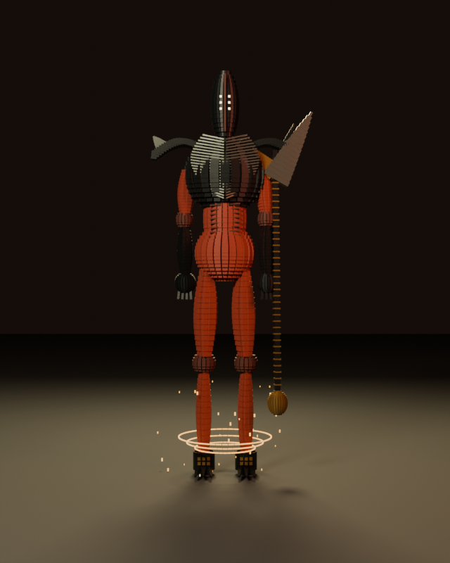
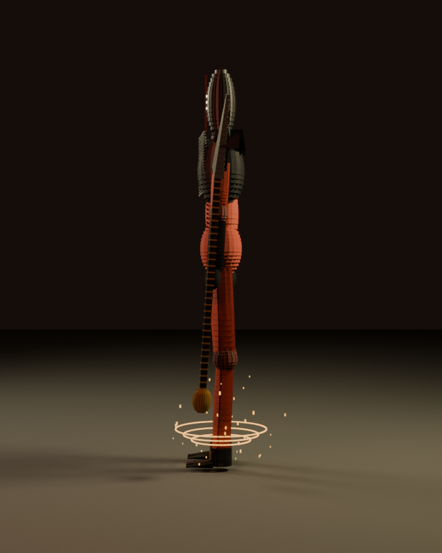
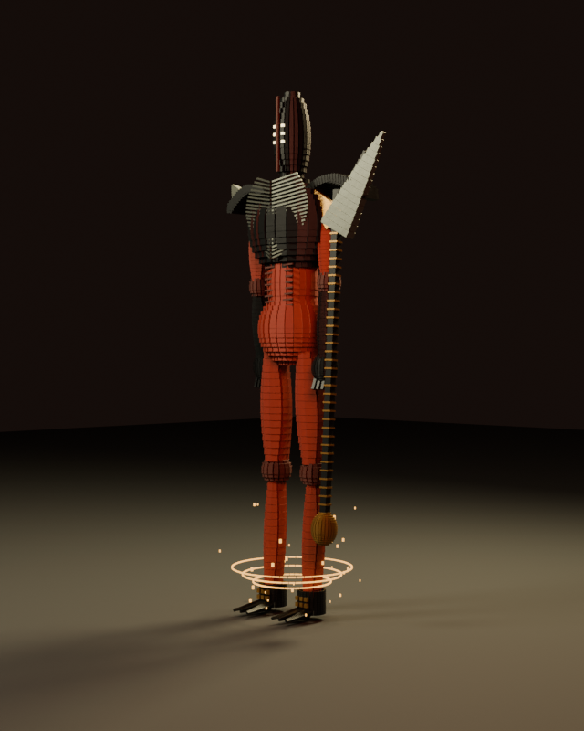
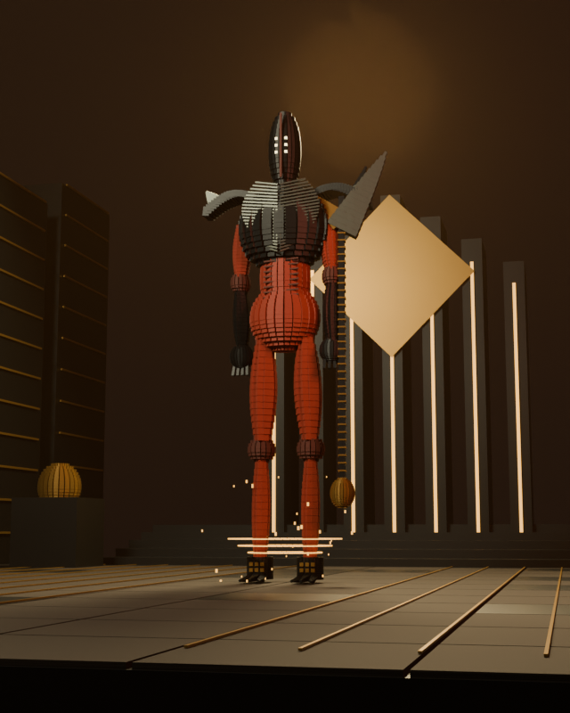
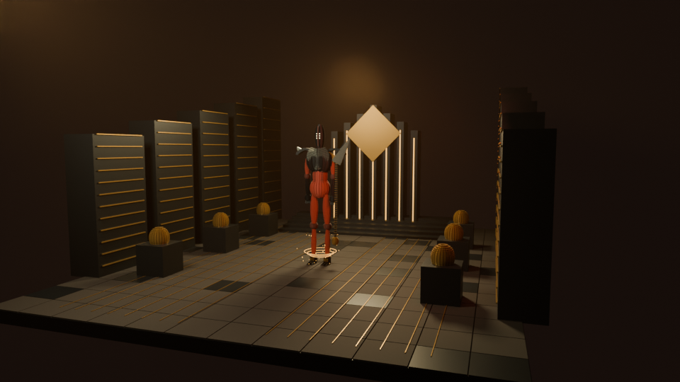
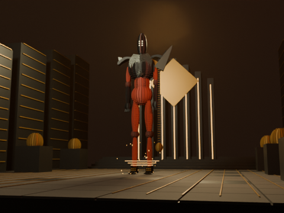
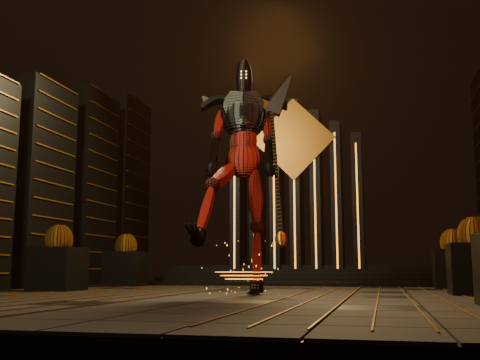
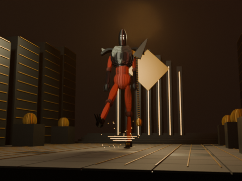
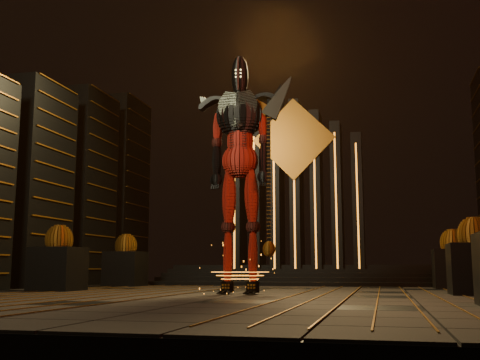

# Rhulk — Disciple of the Witness — Lot C prototype

**Partial dedicated prototype, awaiting visual review. Not user-approved or artistically complete.**

Elongated six-eyed mask, flared collar, slender red/dark torso, long legs/cuffs and an original Lubrae’s Ruin-inspired glaive.

Atlas ID `boss-rhulk` → `vow-of-disciple`. Black/gold Dominion-inspired terraces, reliquaries, floor channels and a resonance-machine backdrop.

[Identity, sources and reconstruction boundaries](../ART-DIRECTION.md) · [Reference URLs and hashes](../references.json) · [Actual render manifest](evidence.json)

| View | Actual Blender PNG |
| --- | --- |
| Front |  |
| Profile — 90° |  |
| Three-quarter — 45° |  |
| Full-body cinematic low angle |  |
| Arena wide |  |

## Animated combat clip

[Actual H.264 animation](animation.mp4) — **36 rendered frames, 24 FPS, 1.5 seconds, 480×360, Balanced, LOD 0**, no audio.

   

Kick preparation and extension articulate hip, knee, torso, arms and glaive. Dash and resonance gestures are separate controls.

All five controls are available: `idle`, `move`, `combat`, `signature`, `reveal`. They are deterministic functions of frame/FPS and articulate multiple joints; this is not a whole-model turntable.

## Technical settings and measured CPU results

Blender official 4.3.2 (32f5fdce0a0a), Cycles/AgX/OpenImageDenoise, seed 42. Stills use Cinematic (128 samples maximum), clips Balanced (48 maximum); adaptive sampling may stop earlier. Every delivered scene uses **explicit LOD 0**, independent of resolution. The arena view is 960×540; anatomical/cinematic dimensions are recorded below.

| Output | Pixels / frames | Actual render sum | Average / frame | Process peak RSS | Report |
| --- | --- | --- | --- | --- | --- |
| front | 640×800 / 1 | 41.92 s | 41.92 s | 806.6 MiB | [JSON](front-report.json) |
| profile | 640×800 / 1 | 30.11 s | 30.11 s | 804.0 MiB | [JSON](profile-report.json) |
| three-quarter | 640×800 / 1 | 37.37 s | 37.37 s | 809.4 MiB | [JSON](three-quarter-report.json) |
| cinematic | 640×800 / 1 | 119.84 s | 119.84 s | 817.9 MiB | [JSON](cinematic-report.json) |
| environment | 960×540 / 1 | 91.34 s | 91.34 s | 824.3 MiB | [JSON](environment-report.json) |
| animation | 480×360 / 36 | 977.96 s | 27.17 s | 580.7 MiB | [JSON](animation-report.json) |

| Explicit LOD | Boss pieces | Joints | Environment pieces |
| --- | --- | --- | --- |
| 0 | 5477 | 22 | 2669 |
| 1 | 1697 | 22 | 769 |
| 2 | 610 | 22 | 295 |

Each report records real device/backend, thread setting, lighting/atmosphere, camera matrix/lens/sensor, render-source hashes, geometry and per-frame pose digests. PNGs are direct Blender outputs; no retouch, generated placeholder or interpolated video frame is substituted. The MP4 is encoded from those real frames.

Native checks: **240 pose evaluations**, five view bounds, **36 clip-frame projections**, zero measured framing overflow, stable objects/meshes and random access. **Physical foot contact is not validated.**

## Remaining limitations

The stride/dash and kick are choreographed, without physics, terrain-aware foot IK or collision/damage. Surface layering and weapon details remain stylized rather than exact. Hip volume and the simplified blade outline need artistic review.

All local runs selected **CPU**, with three rendering threads configured. CPU contention may affect durations; these are not controlled comparative benchmarks. RSS is process memory, not VRAM. GPU/Tesla T4/Colab Pro/Android and actual GPU failure recovery remain untested. No full-length episode, narration or historical Remotion behavior is changed.

See the [Lot C reproduction/Colab guide](../README.md). Source generations and textures are entirely procedural; reference images were observed, never imported as assets.
