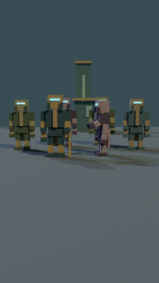
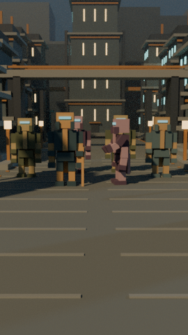

# 0.8.2 — validation and CPU performance

Base main: `cc3aacc3f2d4bc14d4de50c58ce321427cf1476c`. Branch: `feat/cinematic-voxel-environments-0.8.2`. PR: https://github.com/Alexanst54/Destiny-Explained-Studio/pull/15 . Never automatically merged.

## Actual preview comparison

Same frame 210, source actors/joints and camera, same 270×480 resolution. The new environment uses different geometry, atmosphere, material treatment, view transform and sampling, so these timings are **not an isolated geometry-speed comparison**.

| Legacy 0.8.1 | Riis cinematic 0.8.2 |
| --- | --- |
|  |  |

The new frame has terraces/windows, bridge spans, district masses, monument, foreground paving and haze instead of a mostly empty stage. The six actors' transforms and framing are unchanged. This constrained original camera does not expose every valley, stair or district module; the tall monument and background silhouettes approach the upper frame edge. No claim of canonical city accuracy or film-quality parity with external assets is made.

## Measured renders

Blender **4.3.2 / Cycles**, Linux, 3 visible logical CPUs, 2 rendering threads. All three successful PNGs used CPU explicitly. OpenImageDenoise is unavailable in the installed build and disabled with a report note. AgX is used for new environments, Standard for legacy.

| Run | Meshes | Samples / bounces | Resolution | Wall seconds | Blender maximum RSS KiB | PNG bytes |
| --- | ---: | --- | --- | ---: | ---: | ---: |
| Initial balanced prototype, before foreground refinement | 627 | 32 / 3 | 270×480 | 12.938 | 271212 | 253137 |
| Final cinematic | 912 | 96 / 5 | 270×480 | 61.889 | 293408 | 235716 |
| Legacy snapshot, unchanged | 176 | 16 / 2 | 270×480 | 4.615 | 245208 | 196256 |

Wall time surrounds the Blender process (startup, scene creation and PNG writing included). RSS comes from `resource.getrusage(RUSAGE_SELF)` inside Blender on Linux, **not aggregate Node/Chromium/GPU/driver memory**. Node and Chromium are not involved in these PNG renders. No GPU-memory reading was collected. Raw outcomes, exact command arguments, effective settings and PNG SHA-256 values: [environment-validation.json](environment-validation.json). The two small final previews are committed (under 440 KB combined); full-resolution outputs and logs remain ignored under `remotion/out/`.

Cinematic's bounded volume costs substantially more than the haze-free prototype. No final Balanced/Draft PNG or 1080×1920 0.8.2 render was executed, and extrapolation to full resolution/T4 is not a measurement. Import settings for all three final detail levels were checked in Blender. No failed production render, full video or repeated rendering loop occurred in this session.

## Focused tests

Commands from repository root (use Node 22.23.4):

```sh
node --experimental-strip-types --test remotion/blender/tests/export.test.mjs
python -m unittest discover -s remotion/blender/tests -p 'test_*.py'
node remotion/node_modules/typescript/bin/tsc --noEmit --project remotion/tsconfig.json
node remotion/scripts/build-editor.mjs --check
blender --background --factory-startup --python-exit-code 1 --python remotion/blender/tests/blender_check.py -- remotion/blender/examples/riis-frame-210.json
blender --background --factory-startup --python-exit-code 1 --python remotion/blender/tests/environment_check.py
```

- **5 Node tests passed**: existing export/matrices/references/round trip plus old/new schema validation and unchanged actor/camera data.
- **9 Python tests passed**: existing contract, notebook AST/no saved outputs, deterministic quality generation, source immutability, fixture regeneration, invalid inputs/materials/metadata, streaming with no newline, subprocess failure, timeout termination, error report and stale-output refusal.
- **TypeScript and editor asset check passed.**
- **Blender legacy import checks passed**: all 176 transforms, source axes, FOV, shared geometry, preservation of existing scenes, both legacy profiles, spheres and affine shear.
- **Blender environment checks passed**: 392/693/912 objects, quality samples/bounces, haze presence only for cinematic, original camera position, all box vertices in world space with affine preservation.

A notebook assertion initially failed after moving the Blender command into `render_one.py`. The test was updated to verify delegation and flags in that helper, then passed. This was not a failed render. A later Node test invocation in the restricted sandbox exited at the test-worker level before any tests ran (`ERR_TEST_FAILURE`, no test diagnostics); rerunning the same targeted command with normal subprocess access passed all five tests. The intentional failing child process and timeout in unit tests are controlled failure-handling checks, not Blender rendering failures.

## Skipped / limitations

- No new GPU, remote Colab, Android physical or Chromium tests. Notebook cells compile and the same streaming helper is exercised locally; Colab form interactions and downloads still require user validation.
- User-provided 0.8.1 T4/CUDA validation is acknowledged, not relabelled as our 0.8.2 benchmark. CUDA backend code is reused without changes. GPU failure-to-CPU retry remains unexercised locally.
- One environment only. Geometry is intentionally voxel/coarse; mountains are stepped schematic silhouettes, no erosion/terrain solver. Warm windows are emission surfaces, not thousands of separate lights.
- Snapshots only, no Blender armatures/keyframes/video, Remotion image import or audio integration. No changes to existing editor or historical episodes. Unknown data is rejected, not stripped.
- Tests cover deterministic JSON and transform agreement, not bit-identical cross-device Cycles output.
- Extreme user-supplied valid 4096-mesh scenes may exhaust low-memory runtimes; no CPU/GPU throughput guarantee. Geometry cap failure is explicit.

## Inventory and resume

New generator, streaming runner, balanced example, environment tests and Blender checks; additive edits to schema/validator/importer; updated notebook, npm convenience scripts, guides, previews and evidence. No dependencies, backend, Actions, Pages settings or proprietary assets added. Full inventory is available through `git diff --name-status cc3aacc..HEAD`.

Next session: follow [checkpoint journal](../../docs/CINEMATIC-ENVIRONMENTS-PROGRESS.md), open the notebook on Colab Pro with the feature REF, validate a single Balanced preview, then benchmark the same cinematic snapshot CPU vs actual GPU using [the documented procedure](ENVIRONMENTS.md#honest-gpu-benchmark). Download evidence before session teardown. No full video.

### Changed-file inventory

- `README.md`
- `docs/CINEMATIC-ENVIRONMENTS-PROGRESS.md`
- `docs/images/blender-082/riis-cinematic.png`
- `docs/images/blender-082/riis-legacy.png`
- `remotion/blender/Blender-Colab-Pro.ipynb`
- `remotion/blender/ENVIRONMENTS-REPORT.md`
- `remotion/blender/ENVIRONMENTS.md`
- `remotion/blender/README.md`
- `remotion/blender/contract.py`
- `remotion/blender/environment-validation.json`
- `remotion/blender/environments/riis.py`
- `remotion/blender/examples/riis-before-whirlwind.json`
- `remotion/blender/import_scene.py`
- `remotion/blender/render_one.py`
- `remotion/blender/schema.ts`
- `remotion/blender/tests/environment_check.py`
- `remotion/blender/tests/export.test.mjs`
- `remotion/blender/tests/test_contract.py`
- `remotion/blender/tests/test_environment.py`
- `remotion/blender/tests/test_render_one.py`
- `remotion/package.json`
