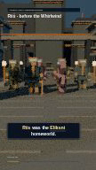

# v0.8.4 — persistent rendering validation

Implemented on `feat/gpu-render-optimization-0.8.4`, based on `main` at `1effd88e089ef4726600a223f97de8fe9abafe78` (v0.8.3 / PR #16). No full 35-second video was rendered. GPU/Colab validation is still required before claiming Tesla T4 performance or completing target-hardware acceptance.

## Delivered behavior

The default sequence renderer launches Blender once for all missing frames in the requested work budget. Riis geometry, materials, lighting and haze load once. Cycles persistent data stays enabled; camera and rig transforms update at the original global frames. Static scene changes reject the batch. Changing rig shear is recomputed from unit vertices rather than accumulated on already deformed vertices. The original single-frame importer remains available through `--renderer single` and automatically handles unfinished frames after a batch crash/timeout (unless `--no-fallback`).

CUDA is tried first; only matching backend devices are enabled. Each successfully rendered frame records the actual selected Cycles configuration. GPU runtime errors get one CPU retry; process crashes/timeouts retain completed frames and batch logs. Optional device-wide NVIDIA telemetry records sampled GPU memory/utilization, or null values with an explanation when unavailable. No NVIDIA hardware was available here.

Content-addressed caches, per-frame hashes, source snapshots, atomic completion markers and the Remotion sidecar contract remain in use. PNG validation now checks CRCs, decoded pixel-stream length/filter bytes and dimensions. Truncated/corrupt PNGs, hash mismatches and malformed completion metadata are cache misses. Old v0.8.3 caches are retained; changed renderer hashes intentionally require new v0.8.4 cache folders. Run one controller per cache job.

The Colab notebook retains Drive narration/cache recovery and mobile-friendly forms. It adds persistent/single selection, batch reports, an MP4 validation step and an opt-in three-quality benchmark. Its default path renders only 120–209; no full-episode rendering was enabled. The original single-PNG notebook is unchanged.

## Measured CPU comparison

One sequential cold-cache trial, baseline first, same ready project, seed 42, dawn lighting, Blender 4.3.2, Cycles CPU, two render threads, same three-CPU affinity. Node v24.22.1 was available locally; the Colab installer remains pinned to Node 22.23.4. Both compared runs used the same local Node binary. No concurrent narration synthesis or other render job ran during the trial.

| 90 frames / 30 FPS | v0.8.3 | v0.8.4 persistent |
| --- | ---: | ---: |
| Draft, 10%, 108×192: total subprocess wall | 135.378 s | 27.073 s |
| Mean total wall / frame | 1.5042 s | 0.3008 s |
| Sequence controller wall (excludes snapshot preparation) | 132.896 s | 24.878 s |
| Peak Blender process RSS | 286736 KiB | 276868 KiB |
| New frames / cache hits | 90 / 0 | 90 / 0 |
| Effective device | CPU | CPU |
| GPU memory / utilization | unavailable | unavailable |

This trial measured **5.0006× lower CPU wall time (80.00% less time)**. It does not establish a GPU speedup or a general performance guarantee. RSS is a process high-water value, not aggregate host or GPU/driver memory. Balanced/25% and Cinematic/50% full 90-frame benchmarks were **not run**. Their reproducible benchmark matrix is implemented and available in the notebook and CLI.

[Raw benchmark evidence](gpu-benchmark-cpu.json) includes commands, versions, revisions, input checksum and effective configurations. The measured render checkpoint is `71dcdc4`; a subsequent cache-metadata type guard and verification/documentation changes do not alter rendering. The pinned baseline is the actual v0.8.3 checkout, not a recreated approximation. The trial order was not randomized and results have not been generalized from repeated trials.

## Visual and audio validation

All **90 decoded RGBA PNGs are pixel-identical to v0.8.3** in the CPU Draft/10% comparison: maximum channel error 0, mean RGB absolute error 0. This verifies the measured profile/device; no equivalent claim is made for unrendered profiles or GPU output.

Blender pose validation evaluated all 90 snapshots forwards and backwards. Maximum world-space vertex error against exported affine matrices was **0.00001538 units**; static Riis mesh pointers remained unchanged, and mesh datablock counts stayed stable. Camera matrices matched at every frame. The test also rejects changed static lights and exercises shear-to-LRS restoration. Existing all-quality environment checks passed for Draft, Balanced and Cinematic, including haze and sample/bounce budgets; these are scene checks, not high-quality sequence benchmarks.

The actual [3-second CPU draft MP4](../../docs/assets/blender-video-084-cpu-draft.mp4) is committed for review: H.264/AAC, 108×192, 90 video frames at 30 FPS, exactly **3.000 s video** / **3.008 s container** with AAC padding. Full FFmpeg decoding passed. The MP4 uses the existing Remotion composition, genuine Kokoro audio, captions and original global source window 4–7s. No narration or caption timestamp was retimed. The excerpt can cut a continuing phrase.

Decoded MP4 audio compared with the original Kokoro WAV window: correlation **0.9994375**, best measured lag **0 ms** (±50ms scan). All frames have six actors, all PNG hashes are distinct, actor/camera poses change and Riis geometry stays static. See [video validation](gpu-video-validation.json). Caption rendering was visually sampled; word timestamps remain synthesis alignments, not new human annotations.

## Reliability checks

A real running 90-frame Blender batch was interrupted by sending SIGINT to its controller after two completion markers appeared. The controller stopped the Blender process group; rerunning the same command reused **2 valid frames and rendered 88**, completing the sequence. A further rerun validated **90 cache hits / 0 new frames**. Deliberately corrupting one PNG then produced **89 hits / 1 replacement frame**. [Raw recovery evidence](gpu-resume-validation.json) records all four stages. Recovery timings are separate from the isolated benchmark and include concurrent validation work.

Unit tests cover partial batch commits followed by a simulated GPU crash, single-frame fallback, strict-mode failure, work limits, malformed markers, CRC corruption, CUDA backend selection, unavailable-GPU CPU selection, process timeout and timeout extension only on completed frames. Actual NVIDIA device loss/OOM has not been injected; a simulated failure is not a GPU test.

## Checks and remaining acceptance work

- 18 Python tests passed, including notebook compilation and empty saved outputs.
- 16 Node bridge/sequence/Hybrid Shorts tests passed; TypeScript and static editor checks passed.
- Blender importer, all-quality environment checks and all-90-frame persistent pose checks passed.
- Validated the real CPU MP4, decoded pixel equivalence, real interruption/resume/cache repair and unchanged single-PNG notebook.

Not executed: Tesla T4 CUDA/OptiX rendering, the three-quality GPU benchmark, real GPU OOM/device-loss recovery, remote Google Colab installation/Drive disconnect recovery, physical Android use, Full HD or full 35-second video. GPU memory and utilization are null, not estimates. A matched-GPU benchmark requires the same effective backend and devices; baseline auto may prefer OptiX while v0.8.4 prefers CUDA, and the harness marks mismatched configurations ineligible for that claim.

Follow [VIDEO-README.md](VIDEO-README.md#reproducible-comparison-on-colab-t4) or the notebook's optional benchmark cell to run all three 90-frame profiles on T4. Keep the ready project, exact revisions, Blender version, seed, lighting, threads and hardware fixed; retain the raw JSON/logs. Validate the 3-second MP4 and audio on that target runtime before considering a full-length render. The PR must remain unmerged pending review.
