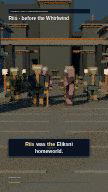

# 0.8.3 — actual validation and handoff

Base latest main `cf2df805b24ac49c90af98a7fe090a2ecf0fa4c5` (merged 0.8.2). Branch `feat/blender-video-pipeline-0.8.3`. PR https://github.com/Alexanst54/Destiny-Explained-Studio/pull/16 . No automatic merge.

## Delivered end-to-end CPU draft

- **90 distinct Blender PNGs**, source frames 120–209 at 30 fps; six existing Eliksni rigs in every frame. Both camera and actor poses change, environment geometry is unchanged between endpoints. No repeated still-frame upsampling.
- Reuses unchanged 0.8.2 Riis generator/materials/dawn lighting and Draft budget: **392 meshes, 8 samples, 2 bounces**, no volume in this lower-quality profile. Cinematic retains its existing volume when selected, but was not sequence-rendered here.
- Actual MP4: `remotion/out/hybrid-riis-07-blender.mp4`, **108×192**, H.264/AAC, **90 video frames / 3.000 s**, container/audio **3.008 s** due to AAC padding, **200989 bytes**.
- Narration is the existing genuine Kokoro 0.7 ready WAV and complete word timestamps, not synthetic test tones or newly estimated timestamps. Remotion preserves the original global 4–7 second window, captions, existing scene transition, source labels and reconstruction notice. The excerpt may cut a continuing phrase; it is not a standalone rewritten short.
- MP4 remains ignored by Git; a small extracted preview and machine-readable [video-validation.json](video-validation.json) are committed.



## Measured CPU/cache results

Blender 4.3.2 / Cycles CPU, two render threads, three visible logical CPUs, Linux. Per-frame process launch is intentionally conservative.

| Execution | New frames | Verified hits | Controller wall seconds |
| --- | ---: | ---: | ---: |
| Work-limited first run | 2 | 0 | 5.184 |
| Actual resumed run | 88 | 2 | 198.128 |
| Actual completed-cache rerun | 0 | 90 | .865 |

Controller measurements begin after snapshot export/preparation, so they are **not entire end-to-end shell times**. The sum of all 90 per-frame Blender subprocess wall measurements is **199.937 s**, including Blender startup/build/render/write. Maximum reported Blender process RSS: **288444 KiB**, not GPU/driver/aggregate system memory. No Node/Chromium memory measurement was collected. Remotion external wall time was not instrumented; none is invented. MP4 encoding completed successfully in Chromium with `--browser-executable=/usr/bin/chromium`.

Decoded AAC vs original WAV source 4–7s: correlation **0.9994447**, best offset **0 ms**, using a ±50ms scan in 1ms increments at mono 24kHz. This validates extraction synchronization, not human annotation of Kokoro word boundaries. All 90 PNG SHA-256 values are distinct. Source frame transforms and static environment endpoint agreement are checked in the verification script.

## Tests actually executed

- **16 Node tests passed**: 5 existing bridge/export tests, 2 sequence schema/mapping tests, 9 existing Hybrid Shorts tests.
- **12 Python tests passed**: existing contract/environment/render-helper tests plus cache/work-limit resume, corruption retry, Full HD preview gate, invalid options and new notebook compilation/forms/no saved output checks. Cache-specific renderer tests use a controlled fake PNG writer; the 90-frame CPU run above separately tests real Blender.
- TypeScript `tsc --noEmit` passed.
- Static editor rebuilt and `build-editor.mjs --check` passed, so the shared optional sequence layer is reflected in GitHub Pages assets.
- Existing PNG notebook is byte-for-byte unchanged from base main.
- One complete low-resolution MP4 rendered, probed and visually sampled. No full 35-second video was rendered.

Commands (Node 22.23.4):

```sh
node --experimental-strip-types --test remotion/blender/tests/export.test.mjs remotion/blender/tests/sequences.test.mjs remotion/tests/hybrid.test.mjs
python -m unittest discover -s remotion/blender/tests -p 'test_*.py'
node remotion/node_modules/typescript/bin/tsc --noEmit --project remotion/tsconfig.json
node remotion/scripts/build-editor.mjs --check
python remotion/blender/verify-video.py remotion/out/hybrid_riis_07-ready.json CACHE_KEY_FOLDER remotion/out/hybrid-riis-07-blender.mp4 remotion/out/video-validation.json
```

Full generation/render commands and cache paths are in [VIDEO-README.md](VIDEO-README.md). The actual local key was `dde5ce32657caf9a1fde473819fdc36dd9b81b90b0eabfa19a63d25853e210c2`, under `remotion/out/blender-video-cache`.

## Unexecuted / remaining limits

- **No new GPU, CUDA, remote Colab or physical Android test.** No Full HD sequence, Balanced/Cinematic sequence or 35-second render. GPU support reuses existing device selection and fallback; GPU performance must be measured on the actual Colab runtime.
- The new notebook compiles, but dependency installation, Drive mount/recovery and mobile interactions have not been executed on Google. Existing PNG notebook remains functional by preservation, not a new remote retest.
- Rendering is sequential and launches Blender per frame; startup dominates tiny previews. Persistent scene batching is deferred. No concurrency on one cache job.
- Cache is verified on persistent disk; `/content` alone cannot survive runtime deletion. Drive is opt-in in the authored notebook; no file was uploaded to Drive by this development session.
- Sidecar is an explicit render input linked by project ID; regenerate after editing the source. GPU/driver identity is recorded per frame but not part of requested-auto cache identity; mixed-device resume may have small pixel differences.
- No automated image-sequence controls in the mobile editor, no new assets/backends, no automatic full-episode compositing. Outside an explicit Blender clip the normal renderer still works.

## File inventory and resume

New: batch snapshot exporter, sequence controller, sequence sidecar schema, dedicated Colab notebook, two focused test files, verification script, guides/evidence/preview and progress journal. Modified: optional HybridShort image branch, episode CLI sidecar/scale support and safe output suffix, test npm command, ignored generated image directory, regenerated Pages preview bundle/service-worker revision. Historical projects, rigs, animation/lighting modules, original PNG notebook and Kokoro synthesis are unchanged.

See [BLENDER-VIDEO-PROGRESS.md](../../docs/BLENDER-VIDEO-PROGRESS.md) for exact continuation. Priority next: validate the notebook on Colab Pro at Draft/10%, inspect actual backend, then preview the desired Cinematic quality before choosing Full HD. Keep matching project/renderer versions and persistent cache. Never start a 35-second render for this PR.
