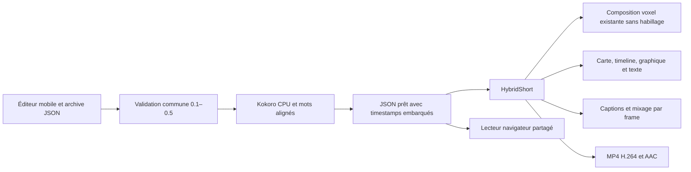

# Hybrid Shorts Director 0.5

Créer un Short vertical depuis l’éditeur Android existant, puis le rendre gratuitement dans Google Colab avec Kokoro et SwiftShader. L’enveloppe d’épisode, l’Atlas 0.3, Living Worlds 0.4 et les compositions historiques sont conservés. Aucun backend, modèle 3D externe, clé payante ou filigrane du studio n’est ajouté.

[Guide mobile](MOBILE.md) · [Rendu Colab](COLAB.md) · [Rapport exécuté et limites](REPORT.md) · [Inspection avant modification](INSPECTION.md)

## Architecture



`HybridShort.tsx` orchestre le contenu courant, ses transitions, les captions et l’audio. `Visuals.tsx` expose un registre extensible pour les composants graphiques. `adapter.ts` produit une projection interne de l’épisode vers la composition voxel existante, sans modifier l’archive. Cette composition reçoit `visualOnly` pour éviter de recopier le décor, les caméras, les acteurs, la météo ou leurs calculs.

Le lecteur officiel `@remotion/player`, verrouillé à **4.0.541**, charge à la demande le même composant que le MP4. Son Shadow DOM évite que le CSS de l’éditeur change la typographie du film. Le bundle reste local dans Pages, sans CDN. Les vidéos anciennes restent sur leurs compositions ; aucun changement de schéma ne leur est imposé.

## Contrat 0.5

L’épisode garde ses champs historiques (`scenes`, `direction`, `audio`, `subtitles`, `characters`, `environments`, etc.). Pour un projet hybride :

- `schemaVersion: "0.5.0"`, `render.composition: "HybridShort"`.
- `shorts.version: 1` : modèle narratif, mode, confiance, sources complémentaires, captions, pistes audio et qualité d’aperçu.
- Chaque `scene` représente un plan du storyboard et possède un `visual` discriminé par `type`.
- `direction.scenes` garde le même ordre que les scènes. Les caméras et overrides voxel restent dans le contrat 0.4 existant.
- Durée totale stricte **450–1800 images**, soit **15–60 s** à 30 fps ; recommandation éditoriale 20–45 s. Les débuts des plans sont continus, sans trou ni chevauchement.

| `visual.type` | Données |
| --- | --- |
| `voxel` | Titre et sources ; `scene.atlas/livingWorld/weather/elements` et `direction` existants |
| `map` | `nodes`, `routes`, caméra schématique avec centres et zooms |
| `timeline` | `events` ordonnés : texte, période, `date` nullable, confiance et sources |
| `graphic` | Cartes d’information, positions, connexions et compteur optionnel |
| `text` | Titre, corps et rôle hook/citation/question/révélation/conclusion |

Chaque visuel possède `headline`, `sources` et `transition: {type, durationFrames}`. Transitions : `cut`, `fade`, `slide`, `zoom`, `wipe`, `flash`, `match`. Maximum 24 images et au plus la moitié du plan. Un cut exige zéro image. Les autres entrées passent par une enveloppe déterministe ; elles ne simulent pas une superposition physique de deux mondes. Le flash est limité à 12 % et ne clignote pas en boucle. En réduction des mouvements, l’aperçu remplace les entrées mobiles par un fondu.

Les positions des cartes sont des **pourcentages schématiques**, jamais des coordonnées astronomiques. Les routes référencent les identifiants de nœuds. Les événements d’une timeline sont ordonnés par l’auteur ; aucune date n’est déduite d’un rang dans la liste. Les dates inconnues restent `null` et sont affichées comme telles. Les connexions et identifiants sont validés.

Le nouveau schéma est dans `schema.ts` et compose le validateur historique. Des champs hybrides placés sur une composition ancienne produisent une erreur explicite, au lieu d’être ignorés. L’Atlas, les variantes, les contrôles de durée des personnages et le budget résolu de **32** restent actifs, y compris après héritage scène/plan. Aucun cast n’est tronqué.

## Captions et aperçu

Styles **Clean Documentary**, **Dynamic Shorts**, **Cinematic Minimal**. Le calcul des segments est partagé, déterministe, limité en mots et en longueur textuelle ; le mot actif change avec ses timestamps. Le texte se replie sur plusieurs lignes, avec réduction mesurée de la police pour les mots longs. Les mots dépassant 120 caractères déclenchent une erreur explicite pour permettre une correction du script.

La zone réserve 180 px à droite, 80 px à gauche et 280–520 px en bas pour les contrôles des plateformes. Il ne s’agit pas d’une garantie sur toutes les interfaces TikTok futures.

Les timestamps doivent couvrir exactement le texte et rester dans leurs plans, via le validateur Kokoro existant. Sans données complètes, l’aperçu affiche **ESTIMATED CAPTION TIMING** et reste silencieux pour la narration. Un rendu final exige des données prêtes et validées. Les frontières de mots Kokoro viennent de durées phonémiques prédites, pas d’une annotation humaine indépendante.

Le JSON prêt embarque aussi `shorts.alignedWords`, permettant de le réimporter sur téléphone sans rechercher un second fichier. Le MP4 utilise les mêmes timestamps via le pipeline existant. Avec des timestamps identiques et des graphiques, les PNG d’aperçu et de rendu final sont identiques dans le test exécuté. L’aperçu voxel peut réduire son DPR pour le téléphone ; la sortie reste 1080×1920.

## Audio et provenance

La voix Kokoro existante reste la piste principale ; `shorts.audio.voiceVolume` règle son volume. Les pistes facultatives contiennent un ID, un type (`effect`, `ambience`, `music`), un début et une durée en images, volume, fondus, gain pendant la voix (`ducking`) et provenance/licence.

Sources autorisées : chemins relatifs sous `public/`, ou audio WAV/MP3/OGG embarqué en data URI. Aucune URL de lecture distante. Un chemin local absent échoue avant le rendu. L’éditeur importe jusqu’à 512 Kio par piste ; le projet doit respecter la limite de transfert Colab de 2 Mio. Le fichier ne boucle pas implicitement. Une durée choisie peut arrêter le fichier ; un fichier plus court finit avant la période réservée.

Le manifeste `shorts.audio.tracks[].provenance` indique titre, auteur, licence (`original`, `CC0`, `CC-BY`), URL de licence et attribution. CC-BY exige attribution et URL ; l’attribution figure dans la vidéo. Le studio vérifie la structure, pas la titularité juridique déclarée par l’utilisateur. Les démos n’utilisent **aucune musique ou ressource audio externe**. Le test de mixage utilise seulement un oscillateur original généré localement.

Fondus et ducking sont des fonctions du numéro d’image et des segments parlés, sans état accumulé. Le rendu final ne demande aucun réseau une fois dépendances, navigateur et poids Kokoro préparés.

## Fidélité et migrations

Les références existantes Atlas et personnages sont accessibles par ID. `shorts.sources` peut ajouter des références HTTPS avec passage précis ; les collisions avec les IDs existants sont refusées. Citations et événements chronologiques exigent des sources. Le script et les modèles restent éditables : aucun fait n’est généré automatiquement. Les conseils de rythme ne prédisent aucune viralité.

Modes : `canonical`, `reconstruction`, `hypothesis`, `alternate-history`. Un modèle **What If?** doit rester hypothétique/alternatif. Un monde Living Worlds alternatif ne peut pas être publié sous un Short de mode ordinaire. Les plans voxel portent un cartouche de reconstitution ; les plans hypothétiques affichent **NOT CANON**.

L’import historique reste dans l’éditeur initial. Les champs inconnus et les variantes de contenu inactives restent dans l’archive intégrale. La copie de rendu écarte explicitement les champs non reconnus, avec rapport. Le changement de type de plan conserve le contenu précédent dans `editorVisualDrafts`, ainsi que les personnages attachés ; l’interface annonce qu’ils sont masqués dans les plans graphiques. Il n’existe pas de conversion destructive automatique d’un projet ancien.

## Développement et reproduction

Depuis `remotion/`, avec Node 22.23.4 et l’environnement Python CPU existant :

```bash
npm ci
npm run typecheck
npm run editor:build
npm run editor:check
npm run test:hybrid
npm run test:hybrid:browser
python scripts/cache-kokoro.py
HF_HUB_OFFLINE=1 python scripts/narration.py episodes/hybrid_riis.json
node --experimental-strip-types scripts/episode.mjs render out/hybrid_riis-ready.json --browser-executable=/usr/bin/chromium --concurrency=1
python scripts/verify_narration.py --episode out/hybrid_riis-ready.json --video out/hybrid-riis.mp4
node scripts/verify-hybrid-render.mjs
```

La commande du navigateur système est facultative si `npm run browser:ensure` a installé le navigateur Remotion. Les MP4, WAV, captures et JSON prêts restent dans les chemins ignorés existants. Le dépôt contient seulement les trois projets de démonstration, le code, les guides et les preuves textuelles.
